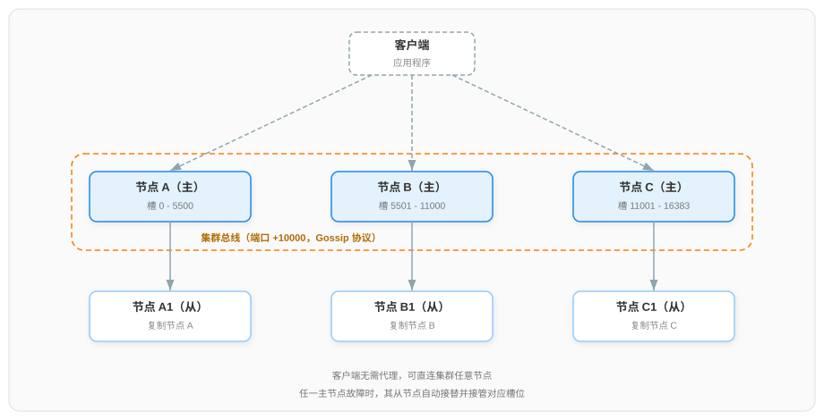

# Redis Cluster 集群配置流程详解

本文讲解 Redis Cluster 集群的完整配置流程：先规划节点拓扑，再完成节点配置，随后创建集群并验证，最后演练扩容、缩容与故障转移。集群的分片、路由与故障转移原理见配套文档[《Redis 集群架构详解》](./Redis%20集群架构详解.md)。

## 一、集群规划

### 1.1 节点拓扑与端口规划

Redis Cluster 要求至少 3 个主节点，生产环境推荐每个主节点配备 1 个从节点，即 3 主 3 从共 6 个节点。本文以本机 6 端口部署演示：

| 节点 | 端口 | 集群总线端口 | 角色 | 数据目录 |
|------|------|------------|------|---------|
| 节点 1 | 7000 | 17000 | 主 | /data/redis-cluster/7000 |
| 节点 2 | 7001 | 17001 | 主 | /data/redis-cluster/7001 |
| 节点 3 | 7002 | 17002 | 主 | /data/redis-cluster/7002 |
| 节点 4 | 7003 | 17003 | 从 | /data/redis-cluster/7003 |
| 节点 5 | 7004 | 17004 | 从 | /data/redis-cluster/7004 |
| 节点 6 | 7005 | 17005 | 从 | /data/redis-cluster/7005 |

每个节点占用两个 TCP 端口：客户端端口与集群总线端口（默认为客户端端口加 10000，用于节点间二进制协议通信）。**两类端口都必须对集群内所有节点开放**，否则节点无法互连。创建时的主从配对（哪个从节点挂在哪个主节点下）由创建命令自动分配，无需预先指定。

集群拓扑与槽位划分示意如下：



### 1.2 注意事项

- Redis 版本 5.0 及以上：集群创建命令 `redis-cli --cluster` 已内置，无需额外的 Ruby 工具；
- 参与集群创建的节点必须是空数据节点：已有数据的实例无法直接加入集群；
- 集群不支持 NAT 与端口映射环境（节点间以真实 IP:Port 互连），Docker 部署需使用 host 网络模式；
- 节点分布上，主节点应位于不同机器，保证多数派不会随单机故障同时丢失。

> Redis 3.0 刚引入 Cluster 时，集群创建与运维依赖官方 Ruby 脚本 `redis-trib.rb`，需要额外安装 Ruby 解释器与 redis gem，但集群协议与核心实现始终由 Redis 自身（C 实现）提供，Ruby 仅负责编排创建流程中的原生命令（组网、槽分配、主从指定）。5.0 版本起该脚本的功能以 C 重写为 `redis-cli --cluster` 内置子命令，Ruby 依赖随之移除，`redis-trib.rb` 同时废弃。

## 二、节点配置

6 个节点的 `redis.conf` 内容一致，仅端口不同。以 `/data/redis-cluster/7000/redis.conf` 为例：

```conf
# 基础配置
port 7000
bind 0.0.0.0
dir /data/redis-cluster/7000
appendonly yes

# 集群模式开关：开启后实例以集群节点身份运行
cluster-enabled yes
# 集群状态持久化文件：节点自动维护，记录集群成员与槽位分配，不接受人工编辑
cluster-config-file nodes-7000.conf
# 节点超时时长（毫秒）：超过该时长未响应即被标记为主观下线（PFAIL）
cluster-node-timeout 5000
# 访问密码（可选）：设置后所有节点需同时配置 requirepass 与 masterauth
# requirepass YourPassword
# masterauth YourPassword
```

四个集群专属配置项的职责：

- **cluster-enabled**：设为 `yes` 后实例进入集群模式，普通单机命令（如 `SELECT`）不再可用；
- **cluster-config-file**：集群状态的落地文件，节点在每次集群状态变化时自动重写，人工不可编辑；
- **cluster-node-timeout**：故障检测的基础时长，影响判定速度与心跳补发阈值；
- **cluster-port**（可选）：自定义集群总线端口，默认为客户端端口加 10000。

## 三、创建集群

### 3.1 启动全部节点

```
redis-server /data/redis-cluster/7000/redis.conf
redis-server /data/redis-cluster/7001/redis.conf
redis-server /data/redis-cluster/7002/redis.conf
redis-server /data/redis-cluster/7003/redis.conf
redis-server /data/redis-cluster/7004/redis.conf
redis-server /data/redis-cluster/7005/redis.conf
```

此时 6 个实例相互独立、各自持有 16384 个槽中的 0 个，尚未组成集群。

### 3.2 执行创建命令

使用 `redis-cli --cluster create` 一次性完成组网、槽分配与主从配对：

```
redis-cli --cluster create 127.0.0.1:7000 127.0.0.1:7001 127.0.0.1:7002 127.0.0.1:7003 127.0.0.1:7004 127.0.0.1:7005 --cluster-replicas 1
```

`--cluster-replicas 1` 表示每个主节点配 1 个从节点。命令会先输出分配方案：前 3 个节点为主节点，分别持有约三分之一的槽（如 0-5460、5461-10922、10923-16383），后 3 个节点作为从节点分别复制三个主节点。确认方案无误后输入 `yes` 执行，命令输出末尾出现 `[OK] All 16384 slots covered.` 即创建成功——它表示 16384 个槽全部有节点负责。

整个创建流程由 `redis-cli --cluster create` 进程编排：它以普通客户端身份连接各节点，依次下发三组指令并轮询确认执行结果：

1. **组网**：向各节点下发 `CLUSTER MEET`，节点收到指令后主动与目标节点建立连接并完成握手，集群视图经 Gossip 传播逐步收敛。此时六个节点纳入同一集群，且均为主节点身份（集群节点的默认身份），但尚未持有任何槽；
2. **槽分配**：向其中三个主节点下发 `CLUSTER ADDSLOTS`，将 16384 个槽的负责权划归三者，它们由此承载实际数据；
3. **主从指定**：向其余三个主节点下发 `CLUSTER REPLICATE`，将其身份由主节点转为从节点，并指定各自复制的主节点。

redis-cli 全程仅承担协调职责，节点间的连接建立与后续数据同步均由节点自身完成。

## 四、集群验证

### 4.1 集群状态

连接任一节点检查整体状态：

```
redis-cli -p 7000 cluster info
```

关键输出：`cluster_state:ok`（集群整体健康）、`cluster_slots_assigned:16384`（槽全覆盖）、`cluster_known_nodes:6`（已知节点数）。

### 4.2 节点与槽分布

```
redis-cli -p 7000 cluster nodes
```

每行输出一个节点，**首列即节点 ID**（40 位十六进制字符），其后为地址、角色标志（master/slave）、连接状态与负责的槽区间，可核对主从配对与槽分配是否与创建方案一致。

### 4.3 读写重定向演示

以集群模式（`-c`）连接，观察键的路由：

```
redis-cli -c -p 7000
127.0.0.1:7000> set user:1 a
-> Redirected to slot [10275] located at 127.0.0.1:7001
OK
127.0.0.1:7001> get user:1
"a"
```

键 `user:1` 属于槽 10275，由 7001 负责，客户端收到重定向提示后自动转向并完成读写——集群模式客户端同时缓存了槽位映射，后续同槽请求将直连目标节点。再以非集群模式连接（不带 `-c`），同样的写入会直接返回 `(error) MOVED 10275 127.0.0.1:7001` 错误文本，这有助于理解重定向机制本身。

## 五、集群运维操作

### 5.1 添加节点

```
redis-cli --cluster add-node 127.0.0.1:7006 127.0.0.1:7000
```

第一个地址为新节点，第二个地址为集群内任一现有节点。新节点加入后不负责任何槽；追加 `--cluster-slave` 参数则将其作为从节点加入。新加入的主节点需要配合下一节的 `reshard` 迁入槽后才承载实际数据。

### 5.2 迁移槽（reshard）

```
redis-cli --cluster reshard 127.0.0.1:7000
```

命令交互式询问三个问题：计划迁移的槽的数量、接收槽的目标节点 ID、槽的来源节点 ID（可指定多个来源，或输入 `all` 从所有主节点均匀抽取）；确认后自动完成"标记迁出/迁入、逐键搬移、归属切换"的完整编排，全程在线不阻塞读写。迁移背后的单槽处理细节见[《Redis 集群架构详解》4.6 节](./Redis%20集群架构详解.md#46-在线扩缩容槽迁移)。

### 5.3 删除节点

```
redis-cli --cluster del-node 127.0.0.1:7000 <节点ID>
```

节点 ID 从 4.2 节 `cluster nodes` 输出的首列获取。删除主节点前必须先通过 `reshard` 将其负责的槽全部迁出；删除从节点无此前置条件。

### 5.4 集群检查

```
redis-cli --cluster check 127.0.0.1:7000
```

输出每个节点的角色、槽区间与主从对应关系，并报告槽覆盖是否完整，用于扩缩容后的例行核对。

## 六、故障转移演练

以 7000 的从节点（如 7003）为例演练自动故障转移：

1. **模拟主节点故障**：`redis-cli -p 7000 shutdown nosave`；
2. **观察判定与切换**：约 5 秒（cluster-node-timeout）后，与 7000 通信超时的节点率先将其标记为主观下线（PFAIL）；PFAIL 标记随 Gossip 心跳扩散，当过半主节点都持有针对它的失效报告时，升级为客观下线（FAIL）并广播全集群，7000 的从节点随即发起选举并接替。后续任一存活节点执行 `cluster nodes`，可见原 7003 节点的标志已变为 master 并持有原 7000 的槽区间；
3. **验证自动收尾**：重新启动原 7000 节点，它读取自身 `nodes-7000.conf` 后发现主节点已存在，自动以从节点身份挂到新主节点下，集群恢复 3 主 3 从形态。

## 七、常见问题排查

1. **创建时报错 `Node is not empty`**
   - 原因：参与集群创建的节点已有数据——集群只能由空节点组建
   - 处理：清空节点数据，或更换空节点
2. **创建时报错 `ERR Invalid node address specified`**
   - 原因：地址格式错误或节点不可达
   - 处理：确认 `ip:port` 书写正确、节点已启动、总线端口放行
3. **写入返回 `(error) CLUSTERDOWN Hash slot not served`**
   - 原因：槽未全覆盖——某段槽无节点负责（主从同时故障或槽分配不完整）
   - 处理：恢复故障节点，或用 `--cluster fix` 修复槽分配
4. **写入频繁返回 `(error) MOVED ...`**
   - 原因：客户端未使用集群模式
   - 处理：改用 `-c` 参数或支持集群模式的客户端库，使其缓存槽位映射并跟随重定向
5. **节点重启后集群状态异常**
   - 原因：残留的旧 `nodes.conf` 与实际集群冲突
   - 处理：本机重建集群时，先停止进程、清空数据目录（含 `nodes.conf` 与持久化文件）再重新创建
6. **Docker 环境节点互相发现异常**
   - 原因：端口映射改变了节点对外地址，破坏总线互通
   - 处理：使用 host 网络模式部署

***

## 参考资料

- [Redis Cluster tutorial | Redis 官方文档](https://redis.io/docs/latest/operate/oss_and_stack/management/scaling/)
- [Redis cluster specification | Redis 官方文档](https://redis.io/docs/latest/operate/oss_and_stack/reference/cluster-spec/)
- [Redis 集群架构详解（配套原理文档）](./Redis%20集群架构详解.md)
