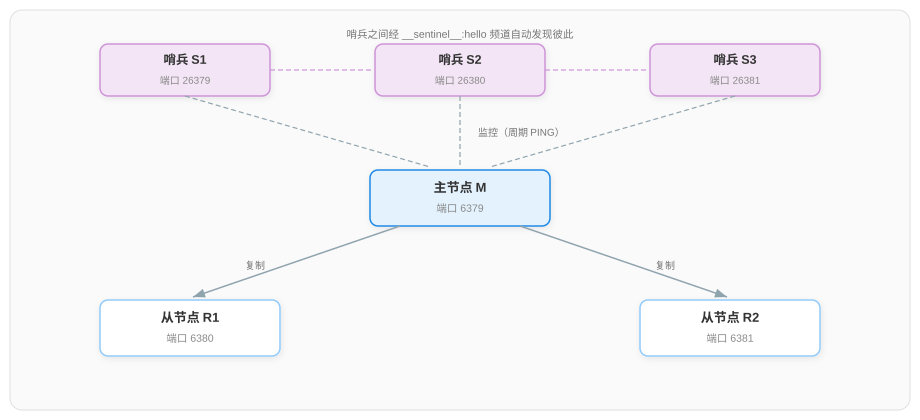

# Redis 主从复制集群配置流程详解

本文讲解主从复制架构与哨兵架构的完整配置流程：先规划节点拓扑，再依次完成主从复制配置与哨兵配置，最后通过故障转移演练验证集群的高可用能力。两种架构的形态与工作原理见配套文档[《Redis 集群架构详解》](./Redis%20集群架构详解.md)。

## 一、集群规划

### 1.1 节点拓扑与端口规划

按照典型生产形态，集群由 1 个主节点、2 个从节点、3 个哨兵组成，共 6 个进程。全部节点部署在本机时以端口区分；生产环境应分布到不同机器上，避免一台机器故障同时损失主节点与哨兵。

| 角色 | 端口 | 配置文件 | 数据目录 | 职责 |
|------|------|---------|---------|------|
| 主节点 M | 6379 | redis.conf | /data/redis/6379 | 处理读写请求 |
| 从节点 R1 | 6380 | redis.conf | /data/redis/6380 | 只读，复制主节点 |
| 从节点 R2 | 6381 | redis.conf | /data/redis/6381 | 只读，复制主节点 |
| 哨兵 S1 | 26379 | sentinel.conf | /data/redis/sentinel1 | 监控与自动故障转移 |
| 哨兵 S2 | 26380 | sentinel.conf | /data/redis/sentinel2 | 监控与自动故障转移 |
| 哨兵 S3 | 26381 | sentinel.conf | /data/redis/sentinel3 | 监控与自动故障转移 |

部署拓扑如下（与上表一一对应），后文各节配置均围绕该拓扑展开：



### 1.2 注意事项

- Redis 版本建议 5.0 及以上：旧版本的 `slaveof` 配置项在 5.0 起更名为 `replicaof`，相关命令同步更名；
- 哨兵要求至少 3 个且为奇数个，本文取 3 个、quorum 取 2（含义见 3.1 节）；
- 若为节点设置访问密码，主节点设 `requirepass`，从节点与哨兵需以 `masterauth`、`sentinel auth-pass` 携带同一密码，本文示例暂不设置密码，涉及项以注释说明；
- 各节点的数据目录需提前创建，Redis 不会自动创建。

## 二、主从复制配置

### 2.1 主节点配置（6379）

在 `/data/redis/6379/redis.conf` 中写入：

```conf
# 基础配置
port 6379
bind 0.0.0.0
dir /data/redis/6379
# 数据持久化：同时开启 RDB 与 AOF，保障主从架构下的数据安全
appendonly yes
# 访问密码（可选）：设置后所有从节点需配置 masterauth，哨兵需配置 sentinel auth-pass
# requirepass YourPassword
```

主节点无需任何复制相关配置——复制方向是由从节点发起的，主节点只需正常运行并接受从节点的连接。

### 2.2 从节点配置（6380、6381）

在 `/data/redis/6380/redis.conf`（6381 同理，替换端口）中写入：

```conf
port 6380
bind 0.0.0.0
dir /data/redis/6380
appendonly yes

# 指定主节点地址与端口：从节点启动后自动连接并同步
replicaof 127.0.0.1 6379
# 主节点访问密码（主节点设置 requirepass 时必配，否则无法通过认证）
# masterauth YourPassword
# 从节点默认只读（默认值即 yes，显式写出以明确意图）
replica-read-only yes
```

`replicaof` 是从节点侧唯一必需的复制配置。其余可选项中，`repl-backlog-size` 调整主节点复制积压缓冲区容量（默认 1MB，写入量大时可调大以减少断线重连后的全量同步），`replica-priority` 设置故障转移时的晋升优先级（默认 100）。

### 2.3 启动与验证

依次启动三个数据节点：

```
redis-server /data/redis/6379/redis.conf
redis-server /data/redis/6380/redis.conf
redis-server /data/redis/6381/redis.conf
```

在主节点执行 `INFO replication` 验证复制状态，关键输出如下：

```
role:master
connected_slaves:2
slave0:ip=127.0.0.1,port=6380,state=online,offset=56,lag=1
slave1:ip=127.0.0.1,port=6381,state=online,offset=56,lag=1
```

`role:master` 与 `connected_slaves:2` 说明两个从节点均已连接；`state=online` 表示复制链路正常。再在从节点执行同一命令，应看到 `role:slave` 与 `master_link_status:up`。

最后验证数据同步：在主节点执行 `SET test:1 ok`，随后在任一从节点执行 `GET test:1` 应返回 `"ok"`（从节点只读，仅可执行查询）。

## 三、哨兵配置

### 3.1 哨兵配置项

哨兵是独立进程，使用独立的 `sentinel.conf` 配置文件。三个哨兵的配置内容一致，以 `/data/redis/sentinel1/sentinel.conf` 为例：

```conf
# 哨兵自身监听端口（默认 26379，多个哨兵同机部署时需各自改端口）
port 26379
dir /data/redis/sentinel1

# 监控主节点：名称 mymaster，地址 127.0.0.1:6379，quorum 为 2
sentinel monitor mymaster 127.0.0.1 6379 2
# 主节点访问密码（主节点设置 requirepass 时必配）
# sentinel auth-pass mymaster YourPassword
# 无有效回复超过该时长（毫秒），单个哨兵将主节点标记为主观下线
sentinel down-after-milliseconds mymaster 5000
# 故障转移后，同时向新主节点重新同步的从节点数量
sentinel parallel-syncs mymaster 1
# 故障转移的整体超时时长（毫秒）
sentinel failover-timeout mymaster 180000
```

三个参数的语义需要准确理解：

- **quorum（`sentinel monitor` 的最后一个参数）**：判定主节点客观下线所需的哨兵票数。取 2 表示 3 个哨兵中有 2 个同意主节点不可达，才会判定下线并尝试发起故障转移；
- **down-after-milliseconds**：单个哨兵判定主观下线的探测超时。示例取 5000 是为了便于演练快速触发，生产环境应结合网络状况放大，避免抖动误判；
- **parallel-syncs**：故障转移完成后，允许几个从节点同时向新主节点发起全量/部分同步。取 1 可保证任一时刻仅一个从节点短暂不可服务，其余从节点继续对外提供读服务。

### 3.2 启动与验证

依次启动三个哨兵（两种启动方式等价）：

```
redis-sentinel /data/redis/sentinel1/sentinel.conf
redis-sentinel /data/redis/sentinel2/sentinel.conf
redis-sentinel /data/redis/sentinel3/sentinel.conf
```

哨兵通过订阅主节点的专用频道自动发现彼此、通过主节点自动发现从节点，启动日志中会出现 `+sentinel` 与 `+slave` 事件，表示发现完成。使用任一哨兵验证监控状态：

```
redis-cli -p 26379 sentinel master mymaster
```

返回字段中重点关注 `flags:master`（监控对象为主节点）、`num-slaves:2`（自动发现 2 个从节点）、`num-other-sentinels:2`（自动发现另外 2 个哨兵）。三项数值正确即组网完成。

## 四、故障转移演练

配置完成后应实际演练一次故障转移，验证高可用能力：

1. **模拟主节点故障**：停止 6379 进程（`redis-cli -p 6379 shutdown nosave`）；
2. **观察判定过程**：约 5 秒（down-after-milliseconds）后，哨兵日志依次出现 `+sdown master`（主观下线）、`+odown master`（达到 quorum 的客观下线）、`+vote-for-leader`（哨兵选举 Leader）；
3. **确认切换结果**：Leader 哨兵从 R1、R2 中选出数据最新的一个提升为主节点，查询当前主节点地址：

```
redis-cli -p 26379 sentinel get-master-addr-by-name mymaster
```

返回的端口应变为 6380 或 6381。对提升后的新主节点执行 `INFO replication`，其 `role` 应已变更为 `master`；对未被提升的另一个从节点执行同一命令，`role` 仍为 `slave`（该节点未被晋升），而 `master_port` 已指向新主节点的端口；

4. **验证自动收尾**：重新启动原 6379 节点。该节点的配置文件中并没有 `replicaof` 配置，因此会短暂以主节点身份启动；但哨兵仍记录着它的地址，发现它重新上线后会向其发送 `SLAVEOF` 命令，将其转为新主节点的从节点，集群恢复 1 主 2 从形态。哨兵随后还会对该节点执行 `CONFIG REWRITE`，把 `replicaof` 配置写入其 redis.conf（如 `replicaof 127.0.0.1 6380`），使配置与运行状态一致——此后该节点再次重启，将直接以从节点身份启动。

演练完成后需注意：哨兵已把故障转移结果写回各配置文件，`sentinel.conf` 中 `sentinel monitor` 指向的主节点地址会被自动更新——这是哨兵的设计行为，不要手工改回。

## 五、常见问题排查

| 现象 | 原因 | 处理 |
|------|------|------|
| 从节点 `master_link_status:down` | 从节点无法连接或认证主节点 | 检查主节点是否存活、`masterauth` 与主节点 `requirepass` 是否匹配 |
| 哨兵日志无 `+slave`、`+sentinel` 事件 | 哨兵与主节点之间网络不通——哨兵依赖主节点完成自动发现 | 检查 26379 端口与主节点的连通性 |
| 主节点故障后始终不发生切换 | 多数派哨兵不可达（哨兵未分布在独立机器），或 quorum 配置大于哨兵数量，客观下线永远无法达成 | 将哨兵分布到独立机器以保证多数派可达；核对 quorum 值不大于哨兵数量 |
| 切换后客户端仍连旧主节点 | 客户端未使用哨兵接入方式 | 通过哨兵查询主节点地址，或改用支持哨兵的客户端库 |
| 主节点重启后从节点数据被清空 | 主节点未开启持久化且被自动重启，重启快于哨兵的下线判定（`down-after-milliseconds`），故障转移未触发，空数据的主节点经全量同步清空从节点 | 主节点开启持久化；或关闭进程自动重启，交由哨兵执行故障转移 |

***

## 参考资料

- [High availability with Redis Sentinel | Redis 官方文档](https://redis.io/docs/latest/operate/oss_and_stack/management/sentinel/)
- [Redis replication | Redis 官方文档](https://redis.io/docs/latest/operate/oss_and_stack/management/replication/)
- [Redis 集群架构详解（配套原理文档）](./Redis%20集群架构详解.md)
