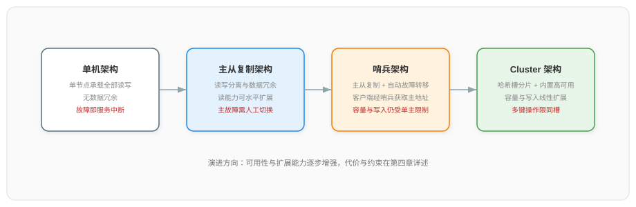
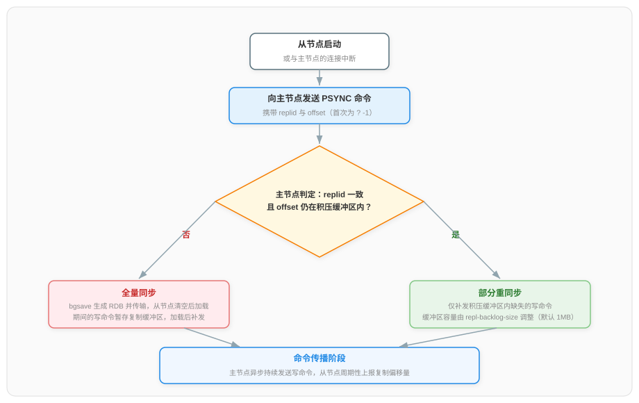
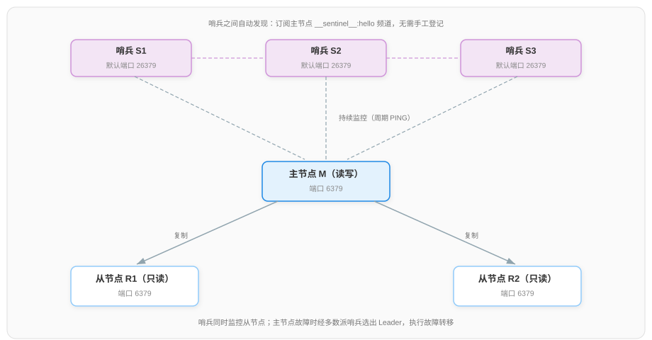
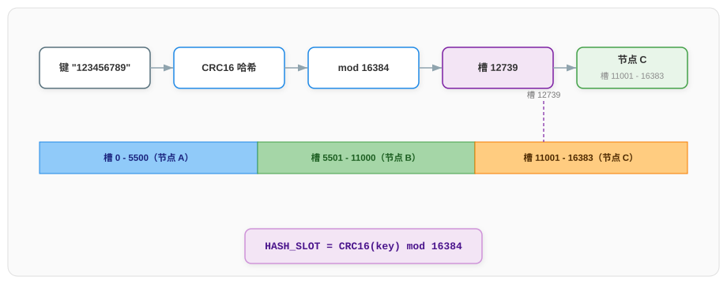
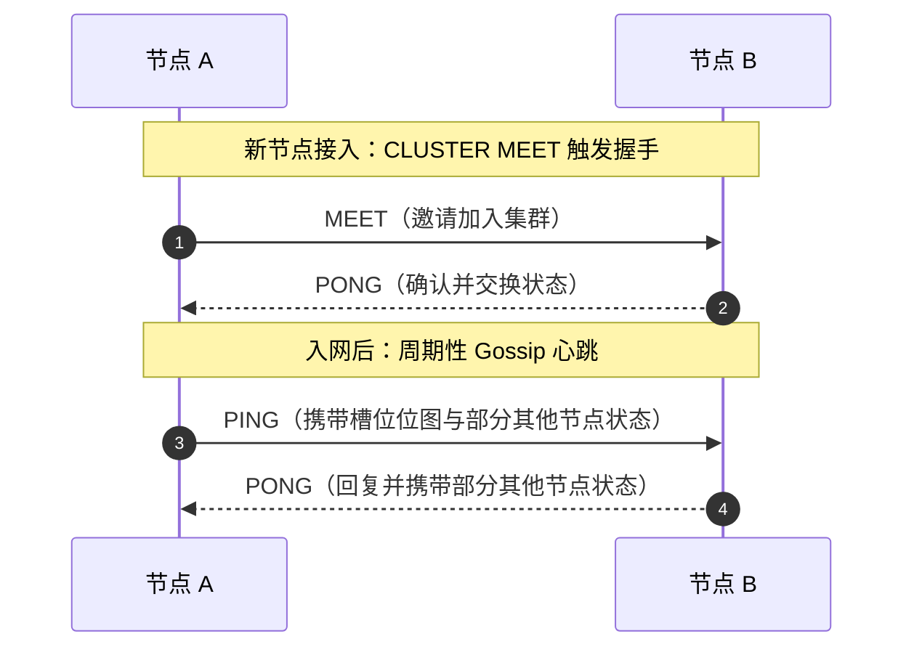
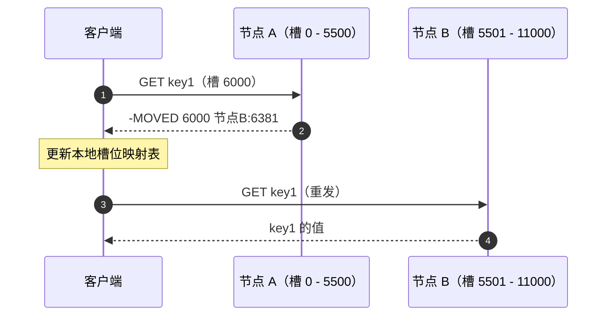
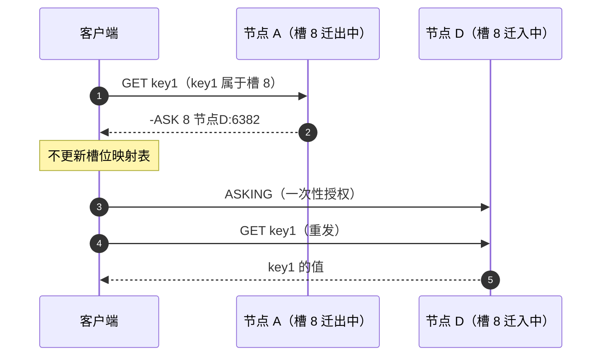
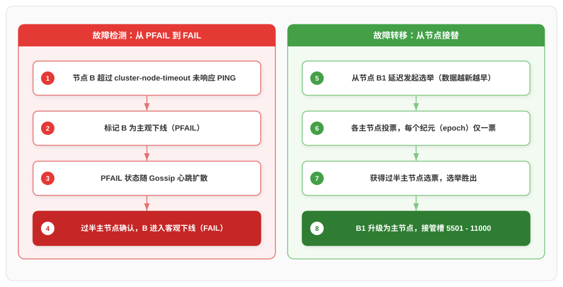
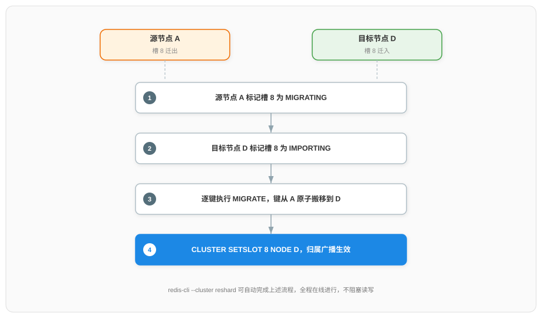

# Redis 集群架构详解

本文梳理 Redis 多节点架构的完整体系：先说明单机架构的限制与多节点架构的两个优化方向，再依次展开主从复制架构、哨兵架构与 Redis Cluster 架构的形态与工作原理，最后给出三种架构的对比与选型建议。各架构的具体配置操作见配套文档《Redis 主从复制集群配置流程详解》与《Redis Cluster 集群配置流程详解》。

## 一、单机架构与多节点架构的引入

### 1.1 单机架构的三个限制

单机架构由一个 Redis 进程独立承载全部读写请求，数据全部保存在该节点的内存中。这一形态部署最简单，但随着业务发展，三个限制会依次暴露：

| 限制 | 成因 | 表现 |
|------|------|------|
| 容量受限 | 全部数据驻留单机内存 | 可存储的数据量上限等于单机内存上限，无法通过加节点扩大 |
| 写入受限 | 全部写入由单实例处理 | 写入吞吐上限等于单实例处理能力上限，无法通过加节点提高 |
| 单点故障 | 进程或机器故障即失去唯一服务节点 | 服务整体中断，恢复依赖人工重启，期间不可用 |

其中"容量受限"与"写入受限"是根本性的：它们源于数据与写入集中在一个节点上，且不能通过增加节点解决。

### 1.2 多节点架构的两个优化方向

针对上述限制，多节点架构沿两个方向展开：

- **可用性方向**：让数据在多个节点上保有副本。写入仍在单一主节点进行，其余节点持续复制主节点数据，主节点故障时由副本节点接替——这由主从复制实现，哨兵再为其补上"自动接替"的能力；
- **扩展性方向**：把键空间分散到多个节点，每个节点只负责一部分数据，容量与写入吞吐随节点数量增长——这是数据分片，由 Redis Cluster 实现。

两个方向都基于**主从复制**这一机制：从节点（replica）持有主节点（master）数据的一份副本并持续保持同步。它在三种架构中的地位不同——主从复制架构直接由这一机制构成，哨兵架构在主从复制架构之上叠加自动故障切换，Redis Cluster 的核心则是数据分片，主从复制只用于单个分片内部、为每个主节点配备从节点以实现故障接替。三种架构解决的问题与遗留的限制如下：

| 架构 | 解决的问题 | 遗留的限制 |
|------|-----------|-----------|
| 主从复制架构 | 数据冗余、读能力扩展 | 主节点故障需人工切换 |
| 哨兵架构 | 在主从复制之上自动完成故障切换 | 容量与写入仍受单主节点限制 |
| Redis Cluster 架构 | 数据分片带来容量与写入扩展，内置故障转移 | 多键操作要求所有键属于同一槽 |

### 1.3 架构演进总览

三种架构并非并列的选项，而是一条逐层补足短板的演进链：哨兵架构建立在主从复制之上，Redis Cluster 内部同样依赖主从复制保证每个分片的可用性。



后文按演进顺序依次展开：第二章说明主从复制的形态与同步原理，第三章说明哨兵如何把"人工切换"自动化，第四章说明 Redis Cluster 如何在分片之上组织数据与高可用，第五章给出对比与选型结论。

***

## 二、主从复制架构

### 2.1 架构形态与读写分工

主从复制架构由一个主节点与一个或多个从节点组成：主节点处理写入请求，从节点通过复制与主节点保持数据一致，并以只读方式对外提供查询。写请求由主节点集中处理，读请求可以分散到各个从节点——这种分工称为读写分离，读能力随从节点数量增加，而写入能力与单机架构相同。

需要首先明确复制的基本性质：**复制是异步的**。主节点执行完写命令立即向客户端返回成功，随后才把该命令传播给从节点，因此从节点的数据会短暂落后于主节点，这段落后时间称为复制延迟。异步复制带来两方面的后果：主节点不会被等待从节点拖慢性能；主节点突然故障时，尚未传播出去的少量写入会随主节点一同丢失。

### 2.2 复制的实现基础

理解同步流程前，需要先认识四个概念，它们共同刻画了"主从之间数据复制到了哪一步"：

- **RDB 快照**：某一时刻全部内存数据的二进制快照文件，可整体传输并在另一个节点上加载，用于把一份完整数据快速送达从节点；
- **复制 ID（replid）​**：主节点首次启动时生成的随机字符串，标记一条复制历史。主从节点拥有相同 replid，说明两者属于同一条复制链路；
- **复制偏移量（offset）​**：主节点每向从节点传播一个字节，偏移量就加一。同一 replid 下，偏移量越大代表数据越新，因此一对 (replid, offset) 能精确标识数据版本；
- **复制积压缓冲区（repl_backlog）​**：主节点在内存中维护的固定长度缓冲区（默认 1MB，可用 `repl-backlog-size` 调整），以环形方式保留最近传播的写命令，供短暂断线的从节点补齐缺失部分。

### 2.3 数据同步流程：全量同步与部分重同步

从节点首次启动，或与主节点的连接中断后重新连上时，会向主节点发送 `PSYNC` 命令，携带自己保存的 replid 与 offset（首次复制时两者为 `?` 与 `-1`）。主节点依据两个条件判断采用哪种同步方式：replid 是否与自己一致，以及 offset 是否仍落在复制积压缓冲区的保存范围内。



**全量同步**发生在从节点首次接入，或 replid 不匹配、offset 已被复制积压缓冲区冲刷掉时。主节点执行 bgsave 生成 RDB 快照并发送给从节点，从节点清空自身旧数据后加载；生成与传输 RDB 期间主节点新执行的写命令，保存在为该从节点单独分配的复制缓冲区中（区别于全局共享的复制积压缓冲区），待从节点加载完成后一并传播。全量同步代价较高：主节点需要执行一次后台快照，网络需要传输全量数据，因此仅在必要时发生。

**部分重同步**发生在已建立复制的从节点短暂断线重连时。若其 offset 对应的命令仍保留在复制积压缓冲区内，主节点只需补发缺失区间的命令，从节点无需清空与重新加载，开销极小。这也解释了复制积压缓冲区大小的意义：它越大，可容忍的断线时间越长；若从节点断线期间主节点的写入量超过它的容量，缺失区间被冲刷，重连后仍会退化为全量同步。

对大写入量的场景，可通过 `repl-backlog-size` 扩大复制积压缓冲区，减少退化概率；对磁盘性能较弱的机器，可启用 `repl-diskless-sync`，让主节点把 RDB 直接经网络发送给从节点，不在磁盘上落地中间文件。

### 2.4 复制的持续运行

同步完成后，主从进入命令传播阶段：主节点每执行一条写命令（包括客户端写入、键过期、键淘汰等所有改变数据的操作），都会异步发送给所有从节点，从节点执行相同命令从而保持一致。同时主节点周期性向从节点发送心跳确认连接，从节点周期性向主节点上报自己的偏移量，主节点据此掌握每个从节点的同步进度。

从节点与主节点的连接中断后会自动重连并按上述流程重新同步，无需人工干预。从节点还可以再挂载自己的从节点（级联复制），把复制流量按层级分摊，适合从节点数量较多的场景。

### 2.5 读写分离的收益与风险

读写分离使读请求分散到多个从节点，且适合把耗时的读操作下放到从节点执行，避免拖累主节点。但使用时必须接受两个前提：

- **可能读到旧数据**。复制是异步的，从节点数据存在复制延迟；主节点写入后立即到从节点读取，可能读到尚未同步的旧值。业务对"写后立即可读"有要求时，读写分离需要谨慎设计；
- **主节点故障时可能丢失少量写入**。2.1 节提到的异步复制代价在故障转移场景下显现：未传播到从节点的写入随故障丢失。对写入安全有更高要求的场景，可使用 `WAIT` 命令让主节点等待指定数量的从节点确认后再返回，但该命令只是降低丢失概率，不改变异步复制的本质。

此外，主从复制本身不包含故障切换：主节点宕机后，从节点会持续尝试重连主节点，服务写请求的能力就此中断，直到人工把某个从节点提升为主节点。这正是下一章哨兵架构要解决的问题。

***

## 三、哨兵架构

### 3.1 哨兵解决什么问题

主从复制架构留下一个缺口：主节点故障后需要人工执行两步操作——把一个从节点提升为主节点，再把其余从节点改挂到新主节点。人工响应的速度决定了服务中断时长，夜间故障则无人响应。哨兵（Sentinel）为消除这一缺口而生：它是一组独立运行的监控进程，持续观察主从节点的状态，在主节点故障时自动完成上述提升与切换，并向客户端告知当前主节点的地址。

哨兵本身不存储业务数据，其价值完全来自"多个哨兵共同工作"。单个哨兵同样是单点：它自身故障或网络抖动时的误判会直接触发错误的切换。因此哨兵要求**至少部署三个且为奇数个**，彼此协作、交叉验证，既降低误判概率，也保证监控体系自身没有单点故障。

### 3.2 哨兵的职责

官方将哨兵的职责归纳为四项：

| 职责 | 内容 |
|------|------|
| 监控 | 持续向主节点与从节点发送探测命令，检查各节点是否正常响应 |
| 通知 | 某个节点出现异常时，通过 API 通知系统管理员或其他程序 |
| 自动故障转移 | 主节点不可用时，将一个从节点提升为新的主节点，其余从节点改挂到新主节点 |
| 配置提供 | 客户端不直接记录主节点地址，而是先向哨兵询问当前主节点是谁；故障转移后哨兵返回新主节点地址 |

第四项职责改变了客户端的接入方式：客户端启动时连接的是哨兵而非 Redis 数据节点，先询问主节点地址，再与主节点交互。故障转移发生后，客户端再次询问即可获得新地址，应用无需修改配置重启。

### 3.3 哨兵组网与部署形态

哨兵从配置文件中获知主节点的地址，与主从节点建立监控关系；哨兵之间则通过订阅主节点上一个专用频道（`__sentinel__:hello`）自动发现彼此，无需手工登记其他哨兵的地址。从节点由哨兵向主节点询问自动获得，同样无需配置。



部署要求可归纳为三点：

1. **哨兵数量至少三个且为奇数**。奇数保证"多数派"判定不会出现平票；部署在不同机器上，避免一台机器故障同时损失多个哨兵；
2. **哨兵默认监听 26379 端口**，多个哨兵之间需要该端口互通；
3. **运行哨兵必须提供配置文件**。哨兵会把监控状态与自动发现的结果写回该文件，重启后据此恢复，无配置文件时哨兵拒绝启动。

### 3.4 故障判定：主观下线与客观下线

主节点故障的判定分两步完成，对应两个概念：

**主观下线（SDOWN）​**：单个哨兵向主节点发送探测命令后，超过 `down-after-milliseconds` 配置的时长仍未收到有效回复，该哨兵就单方面认为主节点已下线。这一判断只代表发出判断的哨兵自己的结论——可能是主节点真的故障，也可能是该哨兵与主节点之间的网络出了问题。

**客观下线（ODOWN）​**：认为主节点下线的哨兵会向其他哨兵询问"你们是否也认为主节点下线"。当同意的哨兵数量达到配置的 `quorum` 值时，主节点被判定为客观下线。客观下线代表多个互相独立的观察者共同确认，单点误判在多数确认下不会成立。

两步设计的因果关系是：单点观察不可靠，所以先用低成本的本地探测给出初步结论；多数观察者交叉验证，才允许触发代价较高的故障转移。

### 3.5 Leader 哨兵选举与故障转移的执行

客观下线只解决了"要不要切换"，还需要解决"由谁执行切换"。哨兵从节点中挑一个执行者，方式是选举：

1. 最先发现客观下线的哨兵向所有哨兵发起拉票，请求对方选举自己为本次故障转移的 **Leader 哨兵**；
2. 每个哨兵在一个纪元（epoch，一次选举的任期编号）内只有一票，先到先得；
3. 获得**超过半数哨兵**选票的候选者当选 Leader，由它执行故障转移。

注意这里出现了两个不同的门槛：`quorum` 用于判定客观下线，**多数派（超过半数的哨兵）​**用于授权故障转移。以 3 哨兵、quorum=2 为例：2 个哨兵同意即可判定主节点下线并尝试发起切换，但切换要执行，还必须有至少 2 个哨兵可达并完成投票——两个条件在 3 哨兵下数值恰好相同，在更多哨兵时则各自独立。

Leader 哨兵当选后执行故障转移，步骤如下：

1. **挑选新主节点**：在原主节点的从节点中按规则择优——优先级（`replica-priority`，数值小者优先，0 表示永不参与）最高者胜出；优先级相同时复制偏移量大（数据越新）者胜出；
2. **提升**：向选中的从节点发送命令使其停止复制、升级为主节点；
3. **改挂**：向其余从节点发送命令，让它们改为复制新主节点；
4. **收尾**：旧主节点恢复后自动降级为新主节点的从节点；哨兵更新自身记录并向客户端提供新主节点地址。

### 3.6 哨兵架构的剩余限制

哨兵把"人工切换"自动化，使主从复制架构具备了生产可用的高可用能力。但它没有触及 1.1 节指出的另外两个限制：全部数据仍在单一主节点的内存里，全部写入仍由单一主节点处理。当数据量接近单机内存上限、或写入吞吐逼近单实例能力上限时，继续增加从节点无济于事——需要把数据本身分散到多个主节点，这正是下一章 Redis Cluster 的主题。

***

## 四、Redis Cluster 架构

### 4.1 数据分片的引入

Redis Cluster 在分片之上重建了主从复制与自动故障转移：键空间被划分为 16384 个哈希槽，每个主节点负责其中一部分槽；每个主节点可以配备从节点做副本，主节点故障时由从节点自动接替。因此 Cluster 架构同时回答了第三章遗留的两个问题——容量与写入的扩展——并保留了自动故障转移能力。

理解 Redis Cluster 需要依次回答四个问题：数据如何划分到节点（4.2）；节点之间如何感知彼此（4.3）；客户端请求如何找到正确的节点（4.4）；节点故障后如何恢复（4.5）；扩缩容时数据如何在节点间移动（4.6）。

### 4.2 哈希槽：键到节点的两级映射

Cluster 没有采用一致性哈希，而是引入**哈希槽（hash slot）​**作为数据划分单元：整个键空间被固定划分为 16384 个槽，编号 0 到 16383。键与节点之间不直接对应，而是经过槽这一中间层完成两级映射：先由固定算法算出键所属的槽，再由集群维护的"槽 → 节点"分配表确定负责该槽的主节点。

```
HASH_SLOT = CRC16(key) mod 16384
```



每个主节点负责一段连续或不连续的槽区间，例如三主节点的集群可将槽划分为三段，分别由三个主节点负责。以键 `"123456789"` 为例：其 CRC16（XMODEM 变体）结果为十六进制 `31C3`，即十进制 12739；再对 16384 取模，结果仍为 12739，该键因此属于槽 12739。槽 12739 落在节点 C 负责的区间（11001 - 16383）内，对该键的读写最终由节点 C 处理——两级映射至此完成。

槽的引入使"数据分布"与"节点数量"解耦：键属于哪个槽由固定公式决定，与集群中有多少个节点无关。向集群加入新节点时，键到槽的映射结果不变，只需把一部分槽的负责权连同槽内数据迁移给新节点，未被迁移的键完全不受影响；这与一致性哈希"节点变动引发相邻环段整体重映射"的方式相比，迁移的粒度与范围都可精确控制。

多键命令、事务与 Lua 脚本要求所有键位于同一槽，Cluster 提供 hash tag 机制支持这一需求：若键名包含 `{...}` 片段，则仅对花括号内的子串计算槽。例如 `user:{1000}:profile` 与 `user:{1000}:orders` 都按 `1000` 计算槽，必然落在同一节点。hash tag 应按业务聚合维度克制使用——它同时把负载绑定到了单一节点，划分不当会造成数据倾斜。

槽位数量的设计依据（为什么是 16384 而不是 65536）来自作者 antirez 的说明：Gossip 心跳包携带本节点的槽位位图，16384 槽对应 2KB，65536 槽会膨胀到 8KB，心跳是高频报文，位图越大带宽开销越大；节点越多，Gossip 传播与故障转移的开销也越大，因此主节点数量不太可能超过 1000。1000 个主节点分摊 16384 个槽，每个主节点平均可持有约 16 个槽，足以支撑细粒度的负载调配。

### 4.3 节点组网与状态同步：集群总线与 Gossip 传播

Cluster 是去中心化架构：没有中心管理节点，每个节点都持有集群的完整状态（有哪些节点、各自负责哪些槽、各节点是否存活），节点之间两两直连组成网状结构。

节点间通信走一条独立的**集群总线**：每个节点在客户端端口之外再开启一个总线端口（默认为客户端端口加 10000，如 6379 与 16379），使用二进制协议交换集群状态，用途包括故障检测、配置更新与故障转移授权。防火墙需同时放行两类端口，节点之间才能互通。

每个节点拥有一个 40 位十六进制字符的唯一 ID（首次启动时生成），节点之间以 ID 而非 IP:Port 互相识别——IP 与端口可能变化，ID 不变。集群状态持久化在节点自动维护的 `nodes.conf` 文件中。

节点之间通过 **Gossip 协议**交换状态：每个节点只需与少量随机节点通信，集群状态信息即可扩散至全网并最终收敛一致。节点间使用五种消息完成这一过程：

| 消息 | 方向 | 用途 |
|------|------|------|
| MEET | 已有节点 → 新节点 | 邀请新节点加入集群（由 `CLUSTER MEET` 命令触发） |
| PING | 节点 → 节点 | 心跳探活，携带自身状态与部分其他节点状态 |
| PONG | 节点 → 节点 | 回复 PING/MEET；也可主动广播（如故障转移完成后通告新配置） |
| FAIL | 节点 → 全集群 | 某节点被判定客观下线后广播，触发其从节点发起故障转移 |
| UPDATE | 节点 → 节点 | 以自身持有的更新配置，纠正对方的过期节点配置 |

PING 与 PONG 报文结构相同，统称心跳包。心跳的规模与频率有两个量化特征：每个心跳携带本节点的槽位位图（2KB）以及随机抽取的约十分之一的其他节点状态（至少 3 个）；每个节点每秒随机选取 5 个节点并向其中最久未通信者发送 PING，同时每 100ms 检查一次本地节点列表，对超过 `cluster-node-timeout` 一半时间未收到 PONG 回复的节点立即补发。

Gossip 传播是最终一致的：状态变更需要经过数轮心跳才能扩散全网，因此任意时刻单个节点掌握的集群视图都可能是过期的。这一特性直接决定了下一节的请求路由方式。



### 4.4 请求路由：MOVED 与 ASK 重定向

Cluster 的节点不代理请求——集中转发会让所有请求多经过一跳，抵消分布式带来的性能收益。取而代之的是**重定向**：客户端可以把命令发给任意节点；若目标键的槽不由该节点负责，节点计算槽号后返回一个重定向错误，由客户端自己转向正确的节点。重定向有两种，对应两种槽归属状态。

**MOVED 表示槽归属已确定变更。​**客户端向节点 A 发送 `GET key1`，key1 属于槽 6000 而槽 6000 由节点 B 负责，节点 A 返回：

```
-MOVED 6000 127.0.0.1:6381
```

错误信息携带槽号与负责节点地址。客户端收到后应更新本地缓存的"槽 → 节点"映射表，再向节点 B 重发命令——此后对槽 6000 的请求即可直连节点 B。



**ASK 表示槽正处于迁移过程中的临时转向。​**槽迁移期间（见 4.6 节），槽内部分键已搬到目标节点、部分仍在源节点，槽归属尚未正式切换。源节点对已迁走的键返回 `-ASK` 错误，客户端的处理与 MOVED 有两点不同：需要先向目标节点发送 `ASKING` 命令（对该客户端的一次性授权）再重发原命令；并且不更新本地槽位映射表，因为迁移结束后槽归属仍以 MOVED 语义为准。



两者可以概括为：MOVED 回答"该槽从此由谁负责"，客户端应更新缓存；ASK 回答"仅这一个键眼下在哪里"，是一次性的例外。主流客户端库（Jedis、Lettuce、redis-py 等的集群模式）会缓存槽位映射并自动处理两种重定向，正常路径下请求直连目标节点，不产生额外往返——这也是 Gossip 最终一致得以成立的前提：客户端先按可能过期的映射直连，错了由重定向纠正。

### 4.5 故障检测与故障转移

Cluster 的高可用内建于集群自身，无需外挂哨兵：每个主节点可配备从节点做异步复制副本，主节点故障时由从节点自动接替。检测与接替的流程与哨兵的思想一脉相承，但执行者是集群节点本身。



**故障检测分两步。​**主观下线（PFAIL）：某节点向节点 B 发送 PING 后，超过 `cluster-node-timeout` 仍未收到 PONG，该节点单方面将 B 标记为 PFAIL。客观下线（FAIL）：PFAIL 标记随 Gossip 心跳扩散，当集群中**过半主节点**都持有针对 B 的失效报告时，B 被判定为 FAIL 并广播全集群。过半确认避免了单节点因自身网络问题误判。

**故障转移由从节点发起。​**被判定 FAIL 的主节点，其从节点基于复制偏移量延迟发起选举——数据越新发起越早，越可能胜出；每个主节点在一个纪元（epoch）内只有一票；获得**过半主节点**选票的从节点成为新的主节点，接管故障主节点的全部槽位并广播新配置，通常在 1-2 秒内完成。

与哨兵架构对照：哨兵架构由独立的哨兵进程监视单一主节点，Cluster 则由主节点们互相监视各自的槽位，两者都采用"过半数确认 + 纪元内单票选举"防止误判与分裂。

故障检测与故障转移机制使集群具备了主节点故障后的自动恢复能力，但其效果需要从两个维度评估：可用性——故障发生时集群能否继续提供服务；一致性——故障与恢复过程中数据是否正确。前者取决于自动故障转移的前提条件，后者受异步复制方式的直接影响。Cluster 的具体表现如下。

**可用性方面**，Cluster 的自动故障转移依赖两个前提：其一，多数派主节点可达——故障转移选举需要获得过半主节点选票；其二，每个主节点在多数派一侧至少有一个可达的从节点——它是故障转移的执行者。两个前提成立时，任意主节点故障都可由其从节点自动接替，集群持续提供服务；当某主节点与其全部从节点同时故障时，该主节点的槽位无节点可服务，默认配置（`cluster-require-full-coverage yes`）下整个集群将拒绝写入，以避免部分数据静默缺失。

**一致性方面**，Cluster 与主从复制相同：采用异步复制，不保证强一致性；最典型的风险是网络分区下的写入丢失，其过程分为三个阶段：

1. **分区形成**：集群被划分为少数派与多数派两侧。少数派一侧的主节点仍在接受客户端写入，但这些写入只存在于少数派节点本地；多数派一侧拥有过半主节点，故障转移可以继续推进——若某故障主节点的从节点位于多数派一侧，它将被提升为新主，配置纪元（epoch）随之增大；
2. **分区恢复**：两侧重新互通后，集群按配置纪元仲裁同一槽的归属，纪元大者胜出。少数派的旧主必须放弃该槽，降级为新主的从节点并重新同步数据，其在分区期间接受的写入随之全部丢弃——分片的读写隔离只覆盖正常路径，分区使同一批槽出现了旧主与新主两个权威，集群必须裁决出唯一权威，落败方的本地数据因此被清除；
3. **丢失窗口的限制**：若无任何防护，分区持续多久，丢失的写入就有多少。停止写入可以限制损失，但停止的时机存在权衡：联络不到多数派既可能源于真实分区，也可能只是短暂的网络抖动——频繁停写会放大偶然故障，持续写入则会让丢失随分区时长无界积累。Cluster 以 `cluster-node-timeout` 为界折中：少数派一侧的主节点在 `cluster-node-timeout` 内联络不到多数派主节点时，即停止接受写入——注定丢失的写入至多积累一个超时时长，丢失写入的时间窗口因此有明确的上限。

### 4.6 在线扩缩容：槽迁移

扩容分两步：先通过 `CLUSTER MEET` 把新节点纳入集群（此时它不负责任何槽），再把部分槽从现有节点划拨给新节点。单个槽的迁移流程如下：



1. **源节点标记迁出**：对源节点执行 `CLUSTER SETSLOT 8 MIGRATING`，槽 8 进入迁出状态；
2. **目标节点标记迁入**：对目标节点执行 `CLUSTER SETSLOT 8 IMPORTING`；
3. **逐键搬移**：循环取出槽内键并逐个执行 `MIGRATE`，键从源节点原子地搬移到目标节点；搬移期间命中已迁走键的请求按 ASK 重定向（即 4.4 节的场景）；
4. **归属切换**：对源、目标节点执行 `CLUSTER SETSLOT 8 NODE <目标节点ID>`，槽归属正式变更并扩散全集群。

整个过程在线进行，不阻塞读写，因此扩缩容不需要停机。生产中通常使用 `redis-cli --cluster reshard` 命令自动完成上述编排；缩容则是逆过程——先把待移除节点的槽全部迁走，再将其移出集群。具体命令操作见配套文档《Redis Cluster 集群配置流程详解》。

***

## 五、三种架构的对比与选型

| 维度 | 主从复制架构 | 哨兵架构 | Redis Cluster 架构 |
|------|------------|---------|--------------------|
| 数据分布 | 单主节点全量 | 单主节点全量 | 16384 槽分片至多主节点 |
| 容量上限 | 单机内存 | 单机内存 | 多节点内存之和，可水平扩展 |
| 写入能力 | 单节点 | 单节点 | 随主节点数量扩展 |
| 读能力 | 随从节点扩展 | 随从节点扩展 | 随节点规模扩展 |
| 故障转移 | 无，人工介入 | 哨兵自动执行 | 集群内置，从节点选举接替 |
| 额外组件 | 无 | 哨兵进程（至少 3 个） | 无 |
| 多键操作与事务 | 完整支持 | 完整支持 | 限同一槽（hash tag） |
| 多数据库 | 支持 | 支持 | 仅 db0 |
| 客户端接入 | 直连节点 | 经哨兵询问主地址 | 集群模式客户端，缓存槽位映射 |

选型可按瓶颈定位：读压力大但数据量与写入量可控时，主从复制配合客户端读写分离即可；可用性要求高、无法接受人工切换时，加部署哨兵；数据量或写入吞吐逼近单机上限、且业务能接受同槽约束与集群模式客户端时，选用 Redis Cluster。三种架构的落地配置分别见《Redis 主从复制集群配置流程详解》与《Redis Cluster 集群配置流程详解》。

***

## 参考资料

- [Redis replication | Redis 官方文档](https://redis.io/docs/latest/operate/oss_and_stack/management/replication/)
- [High availability with Redis Sentinel | Redis 官方文档](https://redis.io/docs/latest/operate/oss_and_stack/management/sentinel/)
- [Redis Cluster tutorial | Redis 官方文档](https://redis.io/docs/latest/operate/oss_and_stack/management/scaling/)
- [Redis cluster specification | Redis 官方文档](https://redis.io/docs/latest/operate/oss_and_stack/reference/cluster-spec/)
- [Why Redis Cluster use 16384 slots? · antirez（redis issue #2576）](https://github.com/redis/redis/issues/2576)
