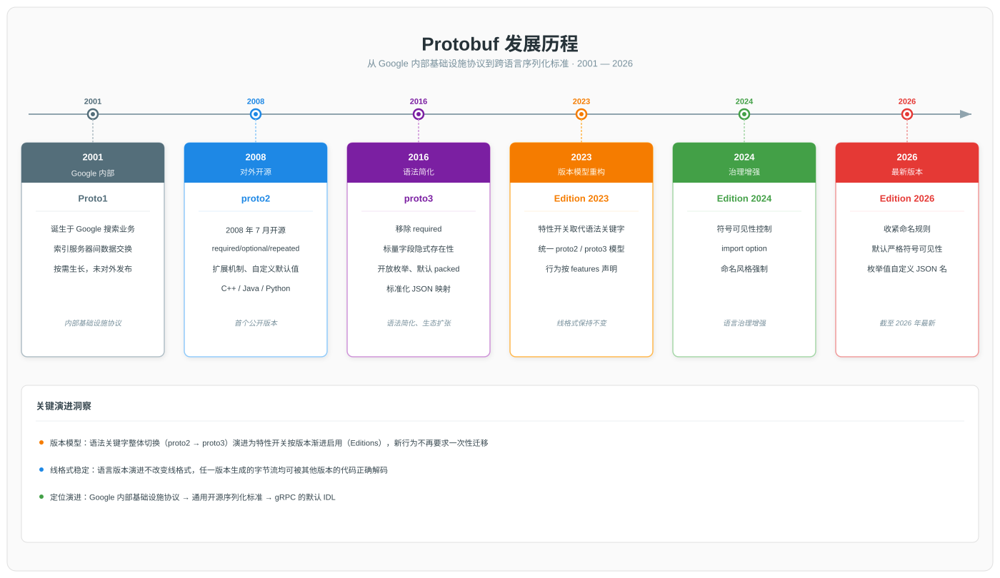
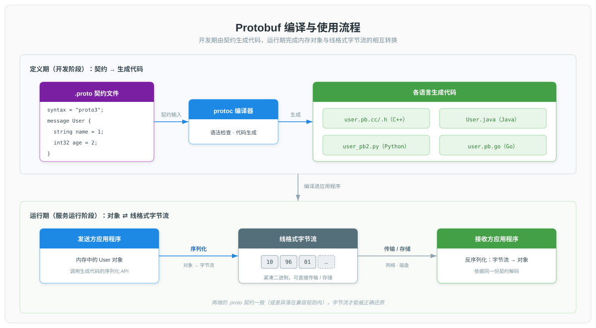
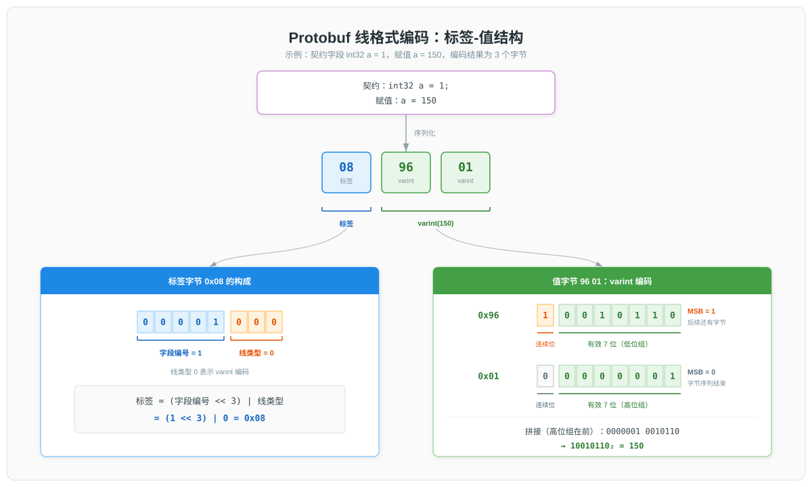
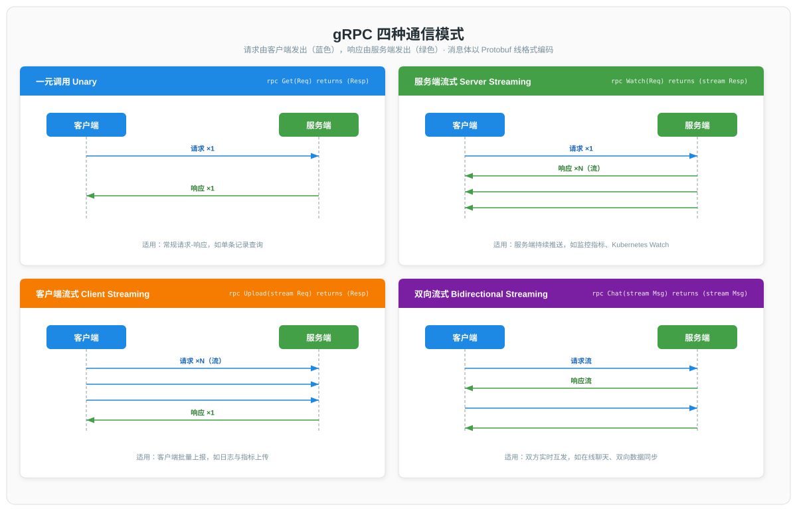

# Protobuf 序列化协议详解

Protocol Buffers（简称 Protobuf）是 Google 推出的语言中立、平台中立、可扩展的结构化数据序列化机制：开发人员以 `.proto` 文件定义数据结构，编译器据此生成多种语言的代码，应用程序调用生成代码完成消息对象与紧凑二进制字节流之间的相互转换。本文从背景、契约与编译、线格式编码、格式对比、兼容性演进、gRPC 集成与工程实践七个层面梳理 Protobuf 的技术体系。

> **名字来源**：名称起源于尚无编译器的早期——当时有一个名为 `ProtocolBuffer` 的类充当消息的字节缓冲区：使用者调用 `AddValue(tag, value)` 之类的方法逐个写入标签与值，消息构造完成后一次性写出，「Protocol Buffers」由此得名。两个词各对应一项延续至今的职能：「Protocol」记录出身——诞生于索引服务器之间的通信协议，今日以契约延续；「Buffers」对应核心职能——将消息对象编码为字节序列，即序列化。

## 术语约定

Protobuf 的资料中存在多个易混用的概念，本文统一约定如下：

| 术语 | 约定含义 |
|------|------|
| 序列化 | 将内存中的消息对象转换为可传输、可存储的字节序列的过程 |
| 反序列化 | 将字节序列还原为内存中消息对象的过程 |
| 契约 | `.proto` 文件中对消息结构与服务接口的定义，是通信双方共同遵守的数据结构约定（亦称 Schema） |
| 线格式 | 序列化产物的字节编码格式，规定每个字段如何映射为字节（Wire Format） |
| 消息 | 一条符合契约定义的结构化数据，是序列化的基本单位 |
| 字段编号 | 契约中为每个字段分配的数字标识，在线格式中代替字段名标识字段 |
| IDL | 接口描述语言（Interface Definition Language），`.proto` 语言即一种 IDL |

## 一、概述

### 1.1 背景问题：分布式系统中的数据交换

分布式系统中，服务运行在不同的进程与机器上，内存对象无法直接跨进程边界传递，必须先序列化为字节序列，经网络或存储介质到达对端后再反序列化还原。序列化格式的选择因此直接影响系统的带宽成本、CPU 开销与协作方式。

早期通用格式 XML 与 JSON 均为文本格式，依靠自描述性获得广泛使用，但这也带来固有开销：

- 字段名随每条消息重复出现，语法符号（引号、冒号、括号、逗号）不携带信息却占用字节
- 解码必须经过文本词法分析，数值还需在文本与二进制之间转换

Google 内部的服务间调用规模庞大（Proto1 的起点正是搜索业务中索引服务器之间的数据交换），上述开销在如此规模下被放大为显著瓶颈，因而催生了对紧凑、快速、跨语言的数据交换格式的需求。

### 1.2 发展历程



| 时间 | 版本 | 关键内容 |
|------|------|------|
| 2001 年 | Proto1（内部） | 诞生于 Google 搜索业务，最初用于索引服务器之间交换数据；特性按需演进、代码状态混乱，从未对外发布 |
| 2008 年 7 月 | proto2 | 首个公开版本；引入 required / optional / repeated 字段标签、扩展机制与自定义默认值；开源时支持 C++、Java、Python |
| 2016 年 | proto3 | 语法简化：移除 required 与自定义默认值，标量字段改为隐式存在性，枚举改为开放语义，repeated 标量默认 packed；标准化 JSON 映射 |
| 2023 年 | Edition 2023 | 以「特性开关」取代语法关键字，统一 proto2 / proto3 的行为模型；行为差异改由 features 逐项声明 |
| 2024 年 | Edition 2024 | 新增符号可见性控制、import option，并强制命名风格 |
| 2026 年 | Edition 2026 | 收紧命名规则、默认严格符号可见性、支持枚举值自定义 JSON 名（截至本文撰写时的最新版本） |

补充说明两点：其一，proto3 曾在 2021 年重新引入 `optional` 关键字，为标量字段恢复显式存在性；其二，语言版本的演进不改变线格式——任一版本生成的字节流均可被其他版本的代码正确解码，这是 5.1 节兼容机制的根基。

### 1.3 解决思路

服务间交换数据的前提是双方对消息结构存在共同理解，即需要一份契约。在此前提下，分布式环境对序列化格式提出四重约束，Protobuf 对每重约束给出了对应的机制：

| 约束 | 含义 | Protobuf 的应对 |
|------|------|------|
| 跨语言 | 多语言技术栈需要统一的数据表示 | 以 `.proto` 契约为单一事实源，编译器为各语言生成等价代码 |
| 传输成本 | 消息体积直接消耗带宽与存储 | 二进制线格式：字段名替换为字段编号，整数按需变长编码 |
| 解析成本 | 编解码消耗 CPU | 解码面向二进制标签，无需文本词法分析；生成代码为每个消息类型定制编解码路径 |
| 演进 | 服务独立部署，新旧版本长期共存 | 线格式以字段编号标识字段并自明边界，配合兼容规则实现新旧代码互解析（第五章） |

## 二、核心概念：契约定义与编译

### 2.1 .proto 契约文件

契约以 `.proto` 文本文件编写。一个典型的 proto3 契约如下：

```protobuf
syntax = "proto3";          // 声明语言版本

package user.v1;            // 命名空间，防止类型名冲突

// 用户消息：一条结构化数据
message User {
  int64 id = 1;             // 字段类型 字段名 = 字段编号
  string name = 2;
  string email = 3;
  repeated string tags = 4; // 可重复字段：可出现 0 到多次
  Address address = 5;      // 嵌套消息字段

  oneof contact {           // 单选字段：同一时刻至多设置其中一个
    string phone = 6;
    string wechat = 7;
  }
}

message Address {
  string city = 1;
  string street = 2;
}
```

| 语法要素 | 作用 |
|------|------|
| syntax | 声明语言版本；Editions 版本改用 `edition = "2023"` 等写法 |
| package | 命名空间，避免不同契约中的同名类型冲突 |
| message | 定义消息类型，即一组带编号的字段 |
| 字段定义 | 由「类型 字段名 = 字段编号」构成，编号是字段在线格式中的身份 |

### 2.2 字段编号

字段编号是 Protobuf 演进模型的核心：线格式只记录编号而不记录字段名，字段的身份由编号承载。编号的使用规则如下：

| 规则 | 内容 | 原因 |
|------|------|------|
| 唯一性 | 同一消息内编号不可重复 | 编号是线格式中字段的唯一标识 |
| 稳定性 | 编号一经发布不可更改 | 更改编号等价于删除旧字段并新增新字段（详见 5.2 节） |
| 单字节区间 | 1—15 的编号可让标签只占 1 字节 | 高频字段应使用该区间（详见 3.1 节） |
| 有效范围 | 1 至 2^29 − 1（536 870 911） | 低 3 位存放线类型，其余 29 位承载字段编号（详见 3.1 节） |
| 保留区间 | 19000—19999 | 为 Protobuf 实现内部保留，编译器拒绝使用 |

### 2.3 标量类型与复合结构

proto3 共定义 15 种标量类型，编码方式由其线类型规定。各标量类型按线类型分组如下（线类型定义见 3.1 节）：

| 分组 | 类型 | 线类型 |
|------|------|------|
| 变长整数 | int32、int64、uint32、uint64、bool | 0（varint） |
| ZigZag 变长 | sint32、sint64 | 0（varint，编码前先经 ZigZag 映射） |
| 32 位定长 | fixed32、sfixed32、float | 5 |
| 64 位定长 | fixed64、sfixed64、double | 1 |
| 长度前缀 | string、bytes | 2 |

> 表中线类型未出现 3 与 4：这两种线类型服务于 proto2 的 groups 特性（分组开始 / 分组结束），现已废弃，proto3 与 Editions 均不再支持，因此现行类型体系仅涉及线类型 0、1、2、5，完整的六种线类型说明见 3.1 节。

在标量类型之上，契约可组合出复合结构：

| 结构 | 语法 | 语义 |
|------|------|------|
| 嵌套消息 | 以消息类型作为字段类型 | 字段值是另一条消息，递归编码 |
| 可重复字段 | repeated | 字段可出现多次且保持顺序；标量数值默认 packed（3.4 节） |
| 单选字段 | oneof | 同一时刻至多一个成员被设置，表达互斥并节省空间 |
| 映射 | map<K, V> | 等价于重复的键值对消息 |
| 枚举 | enum | 取值受限的整数；proto3 要求首值必须为 0（作为默认值） |

### 2.4 编译流程

契约本身不能直接运行，需经编译器转换为编程语言中的代码，整体流程如下：



编译通过 protoc 命令完成，按输出参数为每种语言生成对应代码：

```bash
protoc --proto_path=. --java_out=./out --python_out=./out user.proto
```

流程分为两个阶段：

- **定义期（开发阶段）​**：protoc 读取契约，先做语法检查，再按各语言参数生成源码（如 `User.java`、`user_pb2.py`）。生成代码编译进应用程序，提供三项能力：类型安全的字段访问 API、序列化与反序列化实现、契约的运行时描述（descriptor）
- **运行期（服务运行阶段）​**：发送方调用生成代码将内存对象序列化为线格式字节流；字节流经网络传输或写入存储介质后，接收方依据契约（或差异在兼容规则内的契约，见第五章）将其反序列化还原为内存对象

## 三、线格式编码原理

### 3.1 标签-值结构与线类型

线格式中，每个字段编码为「标签 + 值」两部分：标签记录字段编号与线类型，值按线类型规定的方式编码。线类型共六种：

| 线类型 | 编码方式 | 适用的 .proto 类型 |
|------|------|------|
| 0 | varint（变长整数） | int32、int64、uint32、uint64、sint32、sint64、bool、enum |
| 1 | 64 位定长（小端序） | fixed64、sfixed64、double |
| 2 | 长度前缀 | string、bytes、嵌套消息、packed 的 repeated 字段 |
| 3 | 分组开始 | 已废弃（proto2 groups） |
| 4 | 分组结束 | 已废弃（proto2 groups） |
| 5 | 32 位定长（小端序） | fixed32、sfixed32、float |

以下用最简单的单字段消息演示完整编码：契约定义 `int32 a = 1;`，赋值 `a = 150`，序列化结果为 3 个字节 `08 96 01`。



标签字节的构成在概念上可概括为一句话：标签把字段编号与线类型压缩进同一个 varint——编号左移 3 位腾出低位，线类型填入低 3 位。
> 标签的取值范围被规定为 32 位无符号整数：低 3 位为线类型，其余 29 位为编号，因此编号上限为 2^29 − 1（2.2 节有效范围）；varint 只是这一取值范围的编码方式：按字节追加，最多 5 字节，每字节最高位为连续位属固定分组开销，其余合计 35 位有效容量，但实际有效容量为 32 位。单字节 varint 的有效容量仅 7 位，这划出了编号 1—15 的范围限制（2.2 节单字节区间）。

**编码推导**（标签 0x08）：

- 前提：标签值 = 字段编号左移 3 位后与线类型按位或
- 分步：编号 1 的二进制为 `0000 0001`；左移 3 位得 `0000 1000`；与线类型 0 按位或，结果仍为 `0000 1000`
- 总公式：(1 << 3) | 0 = 8 = 0x08
- 回链：编号 1—15 恰好使标签取值不超过 127，落在单字节 varint 范围内；编号达到 16 后编码标签至少需要 2 字节

### 3.2 varint 编码

varint 以 7 位为一组编码无符号整数：每组有效位装入一个字节，该字节的最高位作为连续位——1 表示后续字节仍属于同一数值，0 表示结束；各组按低组在前的顺序存放。数值越小，占用的字节越少，这是 Protobuf 体积优势的重要来源。

**编码推导**（值 150 → 96 01）：

- 前提：待编码值为 150，二进制 `10010110`
- 分步：按 7 位分组得高组 `0000001` 与低组 `0010110`；各字节最高位置为连续位，得 `1001 0110`（0x96，连续位为 1）与 `0000 0001`（0x01，连续位为 0）
- 总公式：字节序列 `96 01`（低组在前，高组在后），解码时去掉连续位并拼接（高组在前，低组在后），还原 `0000001 0010110` = `10010110` = 150
- 回链：与 3.1 节的标签字节 0x08 拼接，得到完整编码 `08 96 01`

### 3.3 负数与 ZigZag 编码

varint 对小正数高效，对负数却失效。varint 的体积压缩依赖省略前导 0：数值有效位之上的高位 0 不占字节。而负数编码前统一表示为 64 位补码，其高位全为 1，没有任何前导 0 可省，编码长度达到上限——int32 / int64 类型的任何负数都固定占用 10 字节。

这一结论涉及两个层面的区分：类型宽度与编码产物大小。「32 位」是 int32 的类型宽度，描述内存中的表示；「10 字节」是线格式中编码产物的长度，由编码规则决定。varint 族统一以 64 位为编码基准——int32 的负数先经符号扩展为 64 位补码，与 int64 的负数形态完全一致，解码器因此无需区分类型宽度即可解析，这也是 5.2 节 varint 族互相兼容的机制基础。正数不经符号扩展，按实际有效位编码（如 3.2 节的 150 占 2 字节），体积膨胀仅发生在负数上。

**字节量推导**（为何恰为 10 字节）：

- 前提：每个字节承载 7 位有效位（3.2 节）；负数统一以 64 位补码表示
- 分步：64 位按 7 位一组划分，前 9 组承载 63 位、连续位均为 1，剩余 1 位由第 10 组承载、连续位为 0
- 总公式：字节数 = ⌈64 ÷ 7⌉ = 10
- 回链：负数没有任何前导 0 可省，64 位须完整编码，因此任何负数固定占用 10 字节

以 −1 为例：其 64 位补码为 64 个 1，编码为 9 个 0xFF（各承载 7 位有效位）与 1 个 0x01（承载剩余 1 位）。

ZigZag 编码解决这一问题：将有符号整数映射为无符号整数，映射规则让正负数交错排列——0 映射为 0，−1 映射为 1，1 映射为 2，−2 映射为 3，依次类推——使绝对值小的负数同样获得短编码。sint32 / sint64 类型在编码前先做 ZigZag 映射，再进行 varint 编码。

**编码推导**（sint32 的映射公式）：

- 前提：n 为 32 位有符号整数，`>>` 为算术右移（高位补符号位）
- 映射公式：zigzag(n) = (n << 1) ^ (n >> 31)
- 分步：n = −1 时，n << 1 = 0xFFFFFFFE，n >> 31 = 0xFFFFFFFF，异或得 1；n = 1 时，n << 1 = 2，n >> 31 = 0，异或得 2
- 总公式：−1 与 1 分别映射为 1 与 2，单个字节即可编码
- 回链：取值可能为负的字段改用 sint32 后，−1 的编码从 10 字节降为 1 字节

### 3.4 长度前缀与 packed 编码

线类型 2 的值以「长度 + 内容」形式存放：string 的内容为 UTF-8 字节序列，bytes 为原始字节，嵌套消息为该消息自身的线格式字节，长度字段记录内容的字节数。这一设计有两个直接后果：

- 消息可以递归嵌套，解码器无需全局信息即可确定每层的边界
- 解码器遇到无法识别的字段时，可依据标签与长度直接跳过——这是向前兼容（5.1 节）得以实现的机制基础

repeated 标量数值字段在 proto3 中默认采用 packed 编码：全部元素的编码打包进一个线类型 2 的值，标签只出现一次，元素依次紧邻存放。相比每个元素各带一个标签的展开形式，元素越多节省越明显。

## 四、与 JSON、XML 的对比

### 4.1 机制差异与性能表现

文本格式的消息中，字段名与语法符号随每条消息重复出现，而序列化承担的是结构搬运，这些重复并不携带信息。Protobuf 将字段名预先固化在契约中并以编号代替，语法结构由二进制规则隐式表达，整数按数值大小变长分配，体积因此显著缩小。这一设计的代价是格式不再自描述：字段名与语法结构均已移入契约，字节流本身不含结构信息，解码必须依赖契约。解码侧不再进行文本词法分析，数值以二进制原生形态直接读入，生成代码又为每个消息类型定制了编解码路径，速度随之提升。

| 维度 | Protobuf | JSON | XML |
|------|------|------|------|
| 表示形式 | 二进制 | 文本 | 文本 |
| 消息体积 | 小（示例消息约为 JSON 的 60%） | 中 | 大 |
| 编解码速度 | 快 | 中 | 慢 |
| 人类可读性 | 不可直接阅读 | 可读 | 可读 |
| 契约约束 | 强（`.proto` 编译期校验） | 弱（JSON Schema 为可选） | 弱（XSD 为可选） |
| 跨语言支持 | 编译器生成多语言代码 | 各语言原生支持 | 依赖解析库 |
| 演进支持 | 字段编号与兼容规则内建 | 需自行约定 | 需自行约定 |

量化数据方面：对同一示例消息，JSON 编码约 55 字节，Protobuf 约 33 字节；业界基准普遍显示 Protobuf 体积为 JSON 的 30%—60%，编解码耗时通常低数倍，数值密集的消息差距更大。

### 4.2 选型边界

格式选择应从收益条件与代价两方面评估：

- **Protobuf 的收益条件**：消息量大或调用频次高（体积与速度收益被规模放大）、多语言技术栈需要统一契约、接口需要在多年内持续演进
- **Protobuf 的代价**：字节流不可直接阅读，调试依赖工具（7.3 节）；解码必须依赖契约，格式不自描述；浏览器端支持弱于 JSON
- **JSON 的适用面**：浏览器直连场景、面向外部的开放 API、调试可见性优先的场景——即便内部链路使用 Protobuf，对外也常以 JSON 网关暴露
- **XML 的适用面**：面向文档的标记需求、依赖 SOAP 的遗留系统

## 五、兼容性与 Schema 演进

### 5.1 兼容性的定义与实现机制

分布式服务独立部署、升级节奏不一致，新旧版本的代码会长期共存并处理同一批消息字节。为消除译法歧义，本文按「代码版本」与「数据版本」的相对关系定义两种兼容：

| 类型 | 定义 | 达成方式 |
|------|------|------|
| 向后兼容 | 升级后的代码能够读取升级前产生的数据 | 新契约对旧数据中缺失的字段取默认值 |
| 向前兼容 | 未升级的代码能够读取升级后产生的数据 | 旧代码遇到无法识别的字段时跳过或保留 |

需要强调：兼容的前提不是两端契约完全一致，而是契约差异落在兼容规则允许的集合内——两端处理的是同一条消息的字节序列，只要差异不破坏「字段编号 → 编码方式」的对应关系，解码即可正确完成。

这两项能力的机制基础都在线格式一侧：

- 每个字段自带标签，长度前缀类型可直接计算边界，解码器因此能跳过未知字段（proto3 早期版本曾丢弃未知字段，自 v3.5 起恢复保留行为）
- 线格式只记录字段编号，不记录字段名——字段名可以随意修改；默认值不编码，缺失字段在解码侧自然取默认值

### 5.2 安全变更与破坏性变更

| 变更操作 | 安全性 | 原因 |
|------|------|------|
| 修改字段名 | 安全 | 线格式不携带字段名 |
| 新增字段 | 安全 | 双向兼容：旧代码跳过新字段，新代码对缺失字段取默认值 |
| 删除字段 | 有条件 | 字段从契约移除后，历史字节流中仍会出现其编号；必须以 reserved 占位（5.3 节） |
| 修改字段编号 | 破坏性 | 等价于删除旧字段并新增新字段；在新旧契约中不同字段互换编号情况下两端互解码时会出现错位或报错 |
| 复用已删除字段的编号 | 破坏性 | 历史数据中该编号的旧值会被按新字段解读 |
| 跨兼容族修改字段类型 | 破坏性 | 编码方式改变导致解码错误 |

类型修改并非一律破坏性，线格式相同的类型构成兼容族，族内改写安全：

| 兼容族 | 成员 | 说明 |
|------|------|------|
| varint 族 | int32、int64、uint32、uint64、bool | 互相兼容：同一数值的编码产物一致（3.3 节）；注意 int64 改 int32 可能截断 |
| sint 族 | sint32、sint64 | 互相兼容；与其他整数类型不兼容（ZigZag 与补码映射不同） |
| 32 位定长族 | fixed32、sfixed32、float | 互相兼容 |
| 64 位定长族 | fixed64、sfixed64、double | 互相兼容 |
| 文本与字节 | string、bytes | 字节内容为合法 UTF-8 时兼容 |
| 枚举与整数 | enum 与 int32 / uint32 / int64 / uint64 | 兼容 |
| 消息与字节 | 嵌套消息与 bytes | 字节内容为该消息的合法编码时兼容 |

此外，string / bytes / 消息字段的 optional 与 repeated 互改是安全的（两种编码下旧数据均可解析）；标量数值字段则不适用此规则。

### 5.3 演进实践要点

删除字段的规范做法是以 reserved 同时保留编号与名称：

```protobuf
message User {
  reserved 3, 6;
  reserved "email", "phone";
}
```

reserved 之后，任何人在该消息中复用这些编号或名称都会被编译器直接拒绝，从工具链层面杜绝了 5.2 节中最隐蔽的破坏性变更。围绕编号管理，演进的三条要点为：

1. **编号即身份**：发布后的编号永不更改、永不复用；删除只意味着 reserved，而非释放
2. **变更加字段而非改字段**：需要新语义时新增字段，让旧字段自然废弃，两条路径的数据都能被两端正确处理
3. **预留演进空间**：为可能扩展的消息预留编号区间（如一次性编号到 50 再 reserved 16—50），或从一开始采用版本化 package（`user.v1`），结构性质变化时新建 v2 消息

## 六、gRPC 集成

### 6.1 gRPC 与 Protobuf 的协作关系

gRPC 是 Google 于 2015 年开源的高性能 RPC 框架，默认以 Protobuf 为 IDL 与消息编码，以 HTTP/2 为传输协议。二者的分工如下：

| 分层 | 职责 |
|------|------|
| 契约 | 定义服务接口（service）与消息结构（message）；protoc 生成客户端桩代码与服务端骨架代码 |
| 线格式 | 承载方法参数与返回值的消息编码 |
| HTTP/2 | 提供传输通道：多路复用避免队头阻塞、流式帧承载消息序列、头部压缩降低开销 |

这一组合的因果逻辑在于：RPC 需要「契约先行 + 多语言生成」的接口定义方式，Protobuf 的工具链与之完全吻合；RPC 追求高性能，二进制线格式匹配该目标；而 HTTP/2 的流模型天然支持一次调用内的多条消息，为通信模式提供了承载基础。

### 6.2 四种通信模式

依据请求与响应各自是单条消息还是消息流，gRPC 将方法划分为四种通信模式：



| 模式 | 请求 | 响应 | 典型场景 |
|------|------|------|------|
| 一元调用 | 1 条 | 1 条 | 常规请求-响应，如单条记录查询 |
| 服务端流式 | 1 条 | N 条（流） | 服务端持续推送，如监控指标、Kubernetes Watch |
| 客户端流式 | N 条（流） | 1 条 | 客户端批量上报，如日志与指标上传 |
| 双向流式 | N 条（流） | N 条（流） | 双方实时互发，如在线聊天、双向数据同步 |

流式方法在 `.proto` 中以 `stream` 关键字声明：

```protobuf
service UserService {
  rpc GetUser (GetUserRequest) returns (User);                    // 一元调用
  rpc WatchUsers (WatchRequest) returns (stream User);            // 服务端流式
  rpc UploadUsers (stream User) returns (Summary);                // 客户端流式
  rpc Chat (stream ChatMessage) returns (stream ChatMessage);     // 双向流式
}
```

gRPC 保证单个 RPC 调用内每单条流的消息顺序；双向流式下两条流相互独立，读写可任意交错。

### 6.3 生态中的典型应用

以下系统在其通信链路中采用 gRPC（多数同时以 Protobuf 为消息编码）：

| 系统 | 定位 | 与 gRPC 的结合点 |
|------|------|------|
| etcd | 分布式键值存储 | v3 API 基于 gRPC，键值数据以 Protobuf 序列化 |
| Kubernetes | 容器编排平台 | API server 与 etcd 之间经 gRPC 通信，对 etcd 的 Watch 即服务端流式；内置类型以 Protobuf 序列化存储（字节流带 `k8s\x00` 魔数前缀） |
| Envoy | 服务代理 | xDS 动态配置 API 基于 gRPC 流下发 |
| Dubbo 3 | Java RPC 框架 | Triple 协议与 gRPC 兼容，以 Protobuf 为主要序列化方式 |

工程上需要注意：gRPC 默认的单条消息接收上限为 4 MB，超出会报错；消息更大时应分块传输或显式调大上限（并评估内存占用）。

## 七、工程实践与常见问题

### 7.1 契约设计规范

- **编号分配**：高频字段使用 1—15，让标签保持单字节；字段较多的消息按使用频率分段规划
- **类型选择**：取值可能为负的整数一律用 sint32 / sint64，避免负数膨胀为 10 字节（3.3 节）
- **命名空间**：package 携带版本号（如 `user.v1`），为将来整体演进留出空间
- **命名风格**：字段 lower_snake_case、枚举值 UPPER_SNAKE_CASE、消息与服务 PascalCase——Edition 2024 起编译器强制检查

### 7.2 演进治理

- **契约单一事实源**：契约独立于具体服务进行管理（使用独立仓库或独立模块），多语言、多服务从同一份 `.proto` 生成代码，避免各端结构漂移
- **持续校验**：在 CI 中对契约执行 lint 与破坏性变更检测（如 buf 的 `buf breaking` 命令），将 5.2 节的规则固化为工具约束
- **版本迁移**：Editions 模型下迁移只需替换文件首行并显式声明受影响的 features，编译器会报告无法自动迁移的项；线格式不变保证了迁移期间新旧代码持续互通

### 7.3 常见问题

1. **字节流不可直接阅读**
   - 成因：序列化产物为二进制线格式，不具备文本可读性
   - 处理方式：使用 `protoc --decode` 按契约解码，或经标准 JSON 映射输出可读形式
2. **无法区分「未设置」与「零值」**
   - 成因：proto3 隐式存在性下默认值不编码——未显式赋值的字段与显式赋零的字段在字节流中形态相同
   - 处理方式：为字段添加 `optional` 关键字（或 Editions 显式存在性），恢复「是否设置」的记录
3. **长期存储的字节流日后无法解读**
   - 成因：解码依赖契约，格式不自描述
   - 处理方式：将 `.proto`（或编译后的 descriptor）与数据一同归档
4. **单条消息过大触发上限**
   - 成因：gRPC 默认的单条消息接收上限为 4 MB
   - 处理方式：分页或分块传输；确有必要时调大上限，并评估内存占用

## 参考资料

- [Protocol Buffers 官方文档：Overview（Protobuf 定义与工作方式）](https://protobuf.dev/overview/)
- [Protocol Buffers 官方文档：Encoding（varint、ZigZag 与线类型）](https://protobuf.dev/programming-guides/encoding/)
- [Protocol Buffers 官方文档：Language Guide (proto3)（语法、标量类型与字段更新规则）](https://protobuf.dev/programming-guides/proto3/)
- [Protocol Buffers 官方文档：History（Proto1 起源、开源历程与命名由来）](https://protobuf.dev/history/)
- [Protocol Buffers 官方文档：Editions Overview（特性开关模型）](https://protobuf.dev/editions/overview/)
- [Protobuf Explained：Editions（各 Edition 变更明细与时间线）](https://protobuf.com/advanced/editions/)
- [Protobuf Explained：ZigZag Encoding（负数映射原理）](https://protobuf.com/binary/zigzag/)
- [protobuf v3.0.0 Release（proto3 正式发布，2016 年 7 月）](https://github.com/protocolbuffers/protobuf/releases/tag/v3.0.0)
- [Google 开源博客：Protocol Buffers 发布公告（2008 年 7 月）](https://opensource.googleblog.com/2008/07/protocol-buffers-googles-data.html)
- [gRPC 官方文档：Core Concepts（四种通信模式定义）](https://grpc.io/docs/what-is-grpc/core-concepts/)
- [Kubernetes 官方文档：API Concepts（Protobuf 序列化与魔数前缀）](https://kubernetes.io/docs/reference/using-api/api-concepts/)
- [BEE-7004: Encoding and Serialization Formats（同一消息多格式体积对比）](https://alivedise.github.io/backend-engineering-essentials/data-modeling/encoding-and-serialization-formats)
