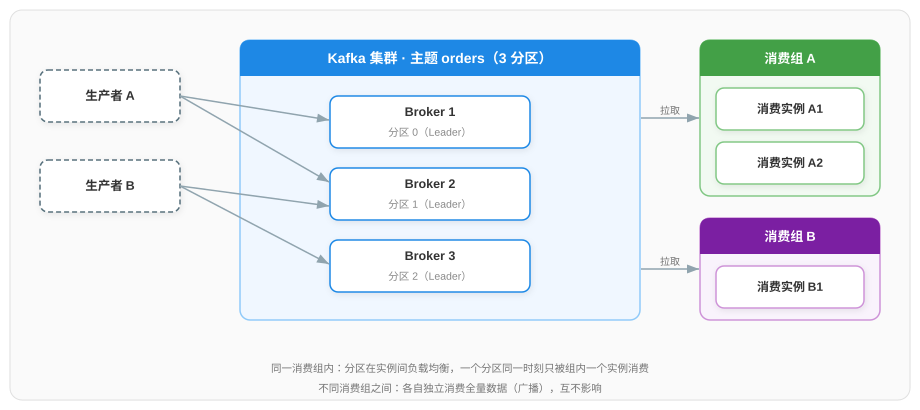
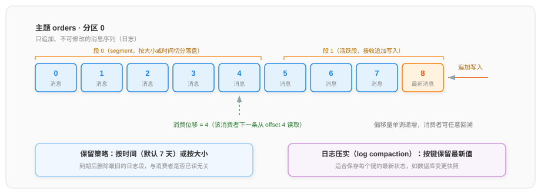
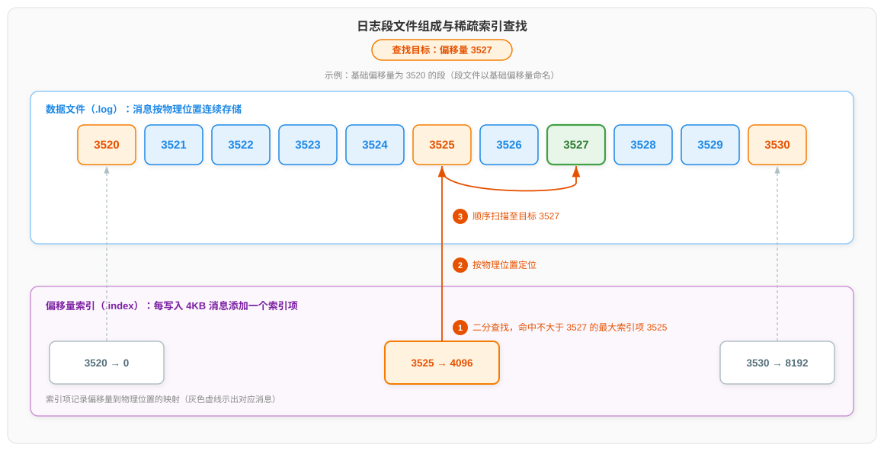
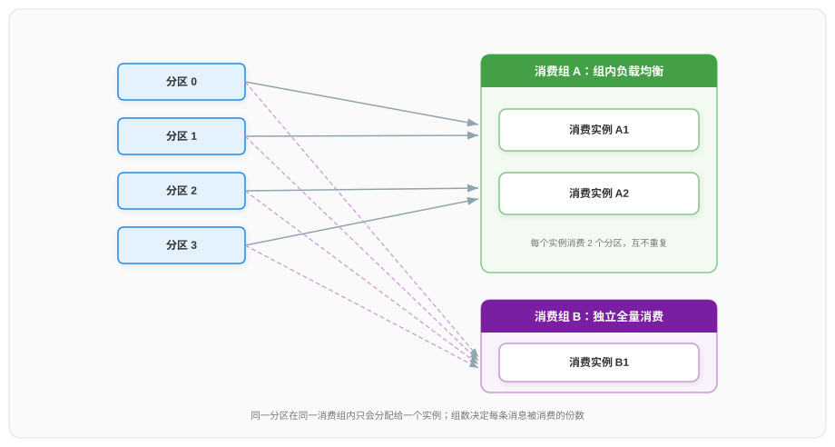
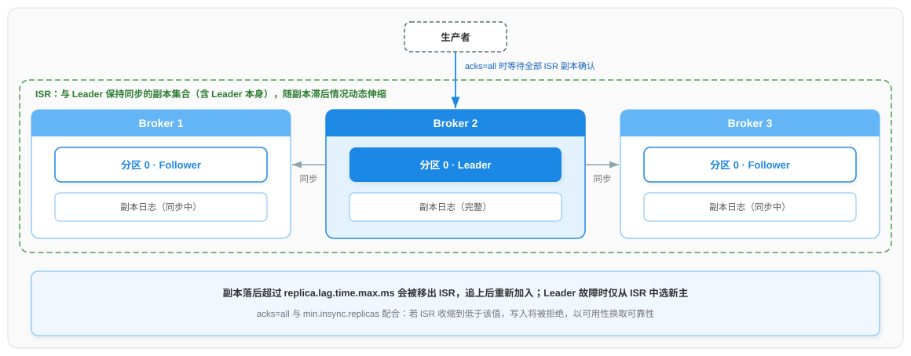

# Kafka 消息中间件详解

本文梳理 Kafka 的技术体系：从消息队列要解决的问题出发，依次说明 Kafka 的整体架构、分区日志的存储设计、生产者与消费者的工作机制、副本机制与集群元数据管理、投递语义与事务，最后归纳典型应用场景与实践要点。各类消息队列之间的横向对比见《消息中间件 MQ 对比详情》。

## 一、消息队列要解决的问题

### 1.1 同步调用方式的三个问题

以下单流程为例：订单服务收到下单请求后，需要依次调用库存服务扣减库存、积分服务增加积分、通知服务发送短信。最直接的做法是同步调用——订单服务逐个发出请求，并等待每个下游服务返回后才继续执行。随着调用链变长、流量增大，这一方式暴露出三个问题：

| 问题 | 成因 | 表现 |
|------|------|------|
| 响应变慢 | 订单服务必须等待全部下游服务执行完毕才能返回 | 三个下游各耗时 100ms，下单接口仅此项就增加 300ms |
| 服务耦合 | 订单服务必须感知每个下游服务的地址与接口 | 新增"发放优惠券"环节需要修改并重新发布订单服务 |
| 故障传播与过载 | 任一下游不可用都会阻塞下单流程；峰值流量直接传导至全部服务 | 通知服务卡顿导致下单失败；大促峰值流量超出下游处理能力，各服务相继失效 |

三个问题的共同根源是：**调用链上的每个环节被强制绑定在同一个时间线上执行**。消息队列的解决方式是在生产者与消费者之间插入一个存储中介：生产者把"发生了什么"写成消息发送到消息队列后即返回，不等待处理结果；消费者按自身处理能力从消息队列获取消息并处理。

### 1.2 消息队列带来的三项能力

引入消息队列后，上述三个问题分别对应三项能力：

- **解耦**：生产者只负责把消息写入消息队列，不关心由谁消费。新增下游时只需新增一个消费者订阅同一消息，上游代码保持不变；
- **异步**：生产者的发送耗时仅为一次写入消息队列的操作（通常毫秒级），写入后即可返回；下游处理在消息队列另一端异步进行，接口响应时间不再随下游数量累加；
- **削峰**：消息先持久化在消息队列中排队，消费者按自身处理能力匀速消费。瞬时洪峰被转化为平稳的队列积压，下游服务不会因过载而失效，洪峰过后积压随消费推进逐步清空。

### 1.3 两种消息模型

消息队列在传递消息时存在两种基本模型：

- **点对点模型**：一条消息只被一个消费者消费，消费后即从队列移除，适合任务分发；
- **发布/订阅模型**：生产者向主题发布消息，所有订阅该主题的消费者都能获得这份消息，适合事件广播。

Kafka 以发布/订阅模型为基础：生产者向主题写入事件，多个相互独立的消费应用各自订阅并处理同一份事件流。5.1 节将说明 Kafka 如何通过消费组在同一模型内同时支持点对点语义。

### 1.4 Kafka 的定位

Kafka 官方将其定位为**事件流平台**，除基本的发布订阅外，还具备另外两项能力：一是**存储**——事件持久化在磁盘上，可按策略保留任意时长，且消费后不删除，允许重复读取与回溯；二是**处理**——通过 Kafka Streams 库或其他流处理引擎（如 Flink）对事件流进行实时加工。官方给出的典型事件流场景包括：实时处理支付与金融交易、物流车辆与货物的轨迹追踪、物联网传感器数据采集分析、零售与移动端的用户交互与订单处理、医院患者状态监测等。

Kafka 中的基本数据单元称为**事件（event，文档中也称 record 或 message）​**，一条事件包含键（key）、值（value）、时间戳以及可选的头部信息，例如键为 `"Alice"`、值为 `"向 Bob 支付了 200 元"`、时间为产生时刻的一条支付事件。

***

## 二、Kafka 整体架构

### 2.1 服务端与客户端

Kafka 是一个分布式系统，由服务端与客户端两类角色经 TCP 协议通信：

- **服务端（Broker）​**：Kafka 以集群方式运行，一部分服务端组成存储层，即 Broker——每个 Broker 保存主题数据的一部分，某台 Broker 故障时其余 Broker 接替其工作；
- **客户端**：写入事件的应用称为**生产者（Producer）​**，订阅读取事件的应用称为**消费者（Consumer）​**，两者完全解耦——生产者不需要等待任何消费者，甚至不知道消费者的存在。这一解耦正是 1.2 节解耦能力在 Kafka 内部的落点。

除基础的命令行工具外，Kafka 提供五个核心 API：Admin API（管理与检查主题、Broker 等对象）、Producer API（写入事件流）、Consumer API（订阅读取事件流）、Kafka Streams API（构建流处理应用，提供聚合、连接、窗口等高级算子）、Kafka Connect API（构建与外部系统之间可复用的数据导入导出连接器，例如持续捕获数据库变更）。

### 2.2 主题与分区

**主题（topic）​**是事件的逻辑归类，类似文件系统中的文件夹，例如 `orders`、`payments`。一个主题可以被零到多个生产者写入，也可以被零到多个消费应用订阅。

主题在物理上被划分为一个或多个**分区（partition）​**，每个分区分布在不同的 Broker 上。分区是 Kafka 并行度的基本单位：生产者与消费者可以同时在多个分区上读写，读写能力随分区数量与 Broker 数量扩展。

分区内部是一条**只追加、不可修改**的消息序列，每条消息在该分区内拥有一个单调递增的整数编号，称为**偏移量（offset）​**。分区有两点关键性质：

- **顺序保证仅限分区内**。同一键的事件总是写入同一分区，因此该键的事件在分区内严格有序；但跨分区的全局顺序没有保证。需要顺序性的业务（如同一账户的操作记录）应以业务键作为消息的键；
- **消费位移由消费者自持**。消费位移就是分区内的一个整数（下一条待读消息的偏移量），这个设计使"已消费到哪里"的状态极小，便于可靠记录与恢复（见 5.2 节）。

### 2.3 整体架构示意

图中主题 `orders` 划分为 3 个分区，分别由 3 个 Broker 持有；两个生产者按分区规则写入，两个消费组各自拉取——消费组 A 内两个实例分担 3 个分区，消费组 B 独立消费全量数据。

### 2.4 保留机制

与"消费后删除"的传统消息系统不同，Kafka 中的事件在被消费后**不会删除**，而是保留到主题配置的保留期限为止，到期后才由存储层删除最旧的数据（清理的执行方式见 3.3 节）。消费后不删除带来两项直接收益：消费者故障重启后可以从上次提交的消费位移继续消费，也可以重置消费位移重新消费历史数据；新上线的消费应用可以直接从历史数据开始处理。同时，Kafka 的读写性能基本不随数据总量增长而下降（原因见 3.1 节），因此长期保留数据在性能上是可行的。

***

## 三、存储设计：分区的日志结构

2.2 节从逻辑上定义了分区——只追加、不可修改的消息序列。本章说明这一设计在存储层的实现：追加写日志如何带来高吞吐（3.1），无限增长的日志如何通过分段与索引保持高效查找（3.2），旧数据如何被清理或压实（3.3）。

### 3.1 追加写日志与顺序读写

每个分区在物理上表现为一组只追加写入的日志文件：新消息永远写入文件末尾，已写入的内容不做任何修改。这一设计是 Kafka 高吞吐的根本原因，其作用机制可以从磁盘的随机读写与顺序读写两种访问模式推导得出。

机械磁盘的每一次读写都由两部分耗时构成：磁头移动到目标磁道的寻道耗时，以及数据本身的传输耗时。随机读写时，相邻操作的访问位置彼此无关，磁头必须为每一次操作重新寻道，寻道耗时在总耗时中占据主导；顺序读写时，数据沿磁道连续分布，磁头一次定位后即可持续传输，寻道开销被摊薄到接近于零，吞吐量逼近介质的连续传输极限。顺序读写因此远快于随机读写，其中顺序写的速度接近内存写入。

追加写使写入方向上的全部操作都是顺序写：写入位置永远位于文件末尾，磁盘写入沿介质单向推进，磁头无需为每条消息重新寻道。读取方向同理：消息按偏移量递增的顺序连续存储在日志中，消费者按偏移量顺序读取，访问的正是连续的磁盘区域，全部读操作都是顺序读。写入与读取两个方向都落在顺序读写这一高效访问模式上，Kafka 由此能以磁盘为存储介质，维持接近内存顺序读写的吞吐水平。

### 3.2 分段与索引

分区日志若只写入单一文件，文件将无限增长，过期的旧数据也无法通过删除文件的方式移除。因此分区日志被切分为多个**段（segment）​**文件：当前段达到大小或时间阈值后关闭、不再修改，新开一个段接收追加写入，正在写入的段称为**活跃段（active segment）​**。每个段只承载某个偏移量范围内的消息，旧段到期后即可整段删除（保留策略见 3.3 节）。

每个段在磁盘上是一组文件：数据文件（.log）存储消息本身，偏移量索引（.index）与时间戳索引（.timeindex）分别支持按偏移量与按时间定位消息。段文件以该段第一条消息的偏移量（基础偏移量）命名，如 00000000000000003520.log；依据各段的文件名，即可判断目标偏移量落在哪个段内。

段内的查找由偏移量索引承担。其索引项记录偏移量到物理位置（消息在数据文件中的字节偏移）的映射。若为每条消息建立索引项（稠密索引），索引文件将与消息数量成正比增长；因此 Kafka 采用**稀疏索引**（sparse index）：数据文件每写入 4KB 消息才添加一个索引项，每个索引项覆盖从对应消息到下一索引项之间的一段消息。

以查找偏移量 3527 的消息为例，图中的过程分三步：

1. **二分查找索引**：索引项按偏移量升序排列，二分查找定位不大于 3527 的最大索引项，命中 3525；
2. **定位物理位置**：按该索引项记录的物理位置，找到数据文件中的消息 3525；
3. **顺序扫描**：从消息 3525 起向后扫描，直至命中目标 3527。

稀疏性同时决定收益与代价：索引文件因索引项稀少而足够小，可以整体驻留内存，二分查找完全在内存中完成；目标消息若未建立索引项，则从距它最近的前一个索引项起顺序扫描，范围被索引间隔限定在约 4KB 内，仍落在 3.1 节所述顺序读这一高效访问模式上。稀疏索引以一个索引间隔内的扫描为代价，换得了索引的常驻内存与段内查找的低开销。

### 3.3 保留与清理

旧的日志段按保留策略清理，支持按时间（`log.retention.hours`，默认 168 小时即 7 天）与按大小（`log.retention.bytes`，默认 -1 即不限制）两种维度，任一维度达到阈值即触发删除，删除以段为单位进行。此外，Kafka 提供一种特殊的清理方式——**日志压实（log compaction）​**：对具有相同键的消息只保留每个键的最新一条，删除更早的历史值。压实适用于"数据本身即某实体的最新状态"的场景，例如将数据库每行记录的最新变更存入一个压实的主题，任何时刻读取该主题都能得到全量最新状态。

***

## 四、生产者：写入路径与可靠性

### 4.1 发送流程

生产者发送一条消息经过四个环节：

1. **序列化**：把键与值对象转换为字节数组；
2. **选择分区**：若消息指定了分区则直接使用；若未指定但带有键，则对键做哈希取模，保证同键消息进入同一分区（这是 2.2 节顺序保证的前提）；不存在按轮询方式分散到各分区的情形；
3. **批量缓冲与压缩**：消息先进入发送缓冲区，同分区的多条消息合并为一个批次并整体压缩，再由后台线程发送——把多次小请求合并为一次大请求，显著提高吞吐；
4. **网络发送与确认**：按确认级别等待 Broker 的响应，决定发送是否成功。

### 4.2 确认级别：acks 参数

`acks` 参数控制"消息被多少副本接收后才算发送成功"，直接决定可靠性与延迟的权衡：

| acks 取值 | 含义 | 风险 |
|----------|------|------|
| `0` | 发出即成功，不等任何确认 | Broker 未收到（如宕机）消息即丢失，延迟最低 |
| `1` | 分区 Leader 写入成功即确认 | Leader 确认后、副本同步前宕机，消息丢失 |
| `all` | ISR 集合内全部副本写入成功才确认（配合 `min.insync.replicas`） | 可靠性最高；ISR 收缩到低于最小同步副本数时写入被拒绝 |

`acks=all` 并不要求"所有副本"都确认，只要求 ISR 集合内的副本确认——ISR 的定义、判定标准与作用在 6.2 节展开。`acks=all` 需与 Broker 端 `min.insync.replicas` 配合使用：该参数规定 ISR 的最小数量（常配为 2，即 Leader 加至少 1 个同步副本），当同步副本数量低于该值时，Kafka 拒绝写入而非返回成功——以牺牲可用性为代价，保证已确认的消息不丢失。

### 4.3 幂等生产者

开启 `acks=all` 后仍存在一种重复场景：Broker 已写入消息，但确认响应在网络中丢失，生产者因收不到确认而重试，同一条消息因此被写入两遍——重试在挽回丢失的同时引入了重复的可能。幂等生产者通过 Broker 端去重解决这一问题：每个生产者实例持有一个生产者 ID，其发送的每条消息携带单调递增的序列号；Broker 检测到序列号重复时，直接丢弃重复副本。幂等性的生效范围是单个生产者会话内的单个分区；跨分区、跨会话的原子写入由第七章的事务机制补齐。

***

## 五、消费者与消费组

### 5.1 消费组模型

消费者通过**消费组（consumer group）​**组织，消费组决定了消息在消费端如何分摊：

- **组内负载均衡**：同一消费组内的多个消费者实例瓜分主题的全部分区，且一个分区同一时刻只分配给组内一个实例——消息在该组内等价于点对点语义，消费能力随实例数扩展；
- **组间广播**：不同消费组各自独立消费全量数据——同一份消息被每个组消费一次，等价于发布/订阅语义。

这一模型把 1.3 节的两种消息模型统一在了同一套机制里。由此可以推出消费组实例数量的约束：**组内消费者实例数超过分区数时，多出的实例分配不到任何分区而处于空闲状态**——扩大消费能力的前提是分区数量足够。

### 5.2 位移管理与提交

消费者在分区内的消费进度称为**消费位移**，其值为下一条待读消息的偏移量（下文简称位移）。位移由消费组统一管理，定期写入 Kafka 的内部主题 `__consumer_offsets`——消费者实例宕机后，同组其他实例接管它的分区时，依据已提交的位移继续消费。

提交位移的时机决定了故障场景下的行为，这是理解消息重复与丢失的关键：

- **先提交位移、后处理消息**：若处理阶段崩溃，重启后从已提交位置继续，崩溃前未处理完的消息被跳过——消息**丢失**；
- **先处理消息、后提交位移**：若处理完成但提交前崩溃，重启后从旧位置重新消费，已处理过的消息被再次处理——消息**重复**。

两种顺序各失去一种保证，无法兼得：不丢失就难免重复，不重复就难免丢失。工程上通常选择"至少一次"（接受重复），再由消费端以幂等方式（如按业务唯一键去重、数据库唯一约束）消除重复的影响。Kafka 链路内的端到端精确一次由事务机制支撑（见第七章）。

### 5.3 重平衡

消费组的成员是动态的：实例加入、退出或崩溃都会改变组成员列表，此时 Kafka 把分区在存活成员间重新分配，这一过程称为**重平衡（rebalance）​**。重平衡期间组内消费整体暂停，直到所有分区重新分配完成——分区数与消费者数较多时，一次重平衡可能持续数十秒，造成消费延迟尖峰。减少重平衡影响的常用手段：为消费者设置合理的心跳与会话超时参数，避免处理耗时过长被误判为故障而移出消费组；使用静态成员资格（`group.instance.id`），使实例短暂重启后重新入组时沿用原有的分区分配，不触发重平衡。

### 5.4 拉模式

消费者获取消息有推、拉两种模式。Kafka 选择**拉模式**：由消费者主动向 Broker 请求批量消息。两种模式的差别在于由谁决定传输节奏：推模式下 Broker 必须决定推送速率，速率难以同时适配处理能力不同的消费者——推送过快会使处理能力弱的消费者过载，推送过慢则使处理能力强的消费者闲置；拉模式下消费者按自身处理能力确定拉取节奏与批量大小，1.2 节所述的削峰由此在读取侧自然实现。代价是 Broker 上无消息时消费者需轮询——Kafka 通过长轮询（无数据时挂起请求，有新消息立即返回）避免了空轮询的开销。

***

## 六、高可用：副本机制与集群元数据

2.1 节提到 Broker 故障时"其余 Broker 接替其工作"，本章说明这一高可用目标的完整实现。若一个分区只有一个副本即仅存于一个 Broker，该 Broker 故障即意味着该分区的数据不可用与服务中断，因此首先为分区引入多个副本（6.1）；副本之间的同步进度存在差异，哪些副本有资格接替 Leader、哪些副本的确认足以代表"写入已安全"，需要统一的判定机制，即 ISR（6.2）；分区 Leader 的指派与 Broker 上下线的处理需要一个集群级协调者，即控制器，其元数据管理方式经历了从 ZooKeeper 到 KRaft 的演进（6.3）；最后将上述机制串联为完整的故障转移过程（6.4）。

### 6.1 副本机制：Leader 与 Follower

副本（replica）是同一分区在不同 Broker 上的完整拷贝，分区的副本数量称为副本因子（生产环境常取 3）。引入多副本后，任一副本所在 Broker 故障，其余副本仍持有该分区的完整数据，数据可用性不再与单个 Broker 绑定。

每个分区的副本中选举一个 **Leader**，负责处理该分区全部读写请求；其余副本为 **Follower**，不处理任何客户端请求，唯一职责是从 Leader 持续拉取消息并写入自身日志（复用消费者的拉取机制），以保持与 Leader 一致。Leader 所在 Broker 故障时，从 Follower 中选出新的 Leader 继续服务——副本机制以此消除单 Broker 故障对分区可用性的影响。

### 6.2 ISR：同步副本集合的判定与作用

Follower 从 Leader 拉取消息存在延迟：Broker 负载高、网络慢都会使某些 Follower 的同步进度落后。"与 Leader 保持同步"需要明确的判定标准，判定标准就是**同步副本集合（ISR，In-Sync Replicas）​**：包含 Leader 自身，以及全部落后程度在阈值内的 Follower——落后程度默认以"落后于 Leader 末端位置的时长"（`replica.lag.time.max.ms`）衡量。Follower 落后超过阈值即被移出 ISR，追上后重新加入，因此 ISR 处于动态收缩与扩张之中。

ISR 划定两件事的边界，二者共同构成"已确认消息不丢失"的保证：

- **写入确认的范围**：`acks=all` 要求 ISR 内全部副本写入成功才确认（见 4.2 节）；
- **Leader 选举的候选范围**：Leader 故障时，新 Leader 只从 ISR 中选出。

两项职责的组合效果是：一条消息被确认时已存在于全部 ISR 副本上，而新 Leader 又只从 ISR 中产生，因此被确认的消息在故障转移后不会从新 Leader 上消失。该保证的强度取决于 ISR 的大小：ISR 可能因 Follower 持续落后而收缩到只剩 Leader 自身，此时 `acks=all` 的写入仅由 Leader 单独确认，Leader 一旦故障这条消息即丢失。为此，Kafka 引入 `min.insync.replicas` 规定 ISR 的最小数量（常配为 2，即 Leader 加至少 1 个同步副本）：ISR 低于该值时 Broker 拒绝写入——以放弃写入可用性为代价，保证已确认的消息不丢失（4.2 节的结论由此而来）。

这一设计与多数派共识算法形成对照：Raft 等共识算法把确认副本数固定为过半数——任意两个多数派必有交集，保证新 Leader 必然持有全部已提交数据，安全性与配置无关。Kafka 则把"哪些副本参与确认"与"至少多少个副本参与确认"拆分为两个可独立变化的部分：前者由动态 ISR 依据实际同步状态确定，后者由 `min.insync.replicas` 按业务要求配置。副本因子 3、`min.insync.replicas=2` 时，每次写入等待 2 个副本确认，安全性与三副本多数派相当；若把 `min.insync.replicas` 配置为 1，写入只需 Leader 确认，延迟更低，但故障时丢失已确认消息的风险相应增大——安全边界由此从协议的固定值转变为运维的配置项。

### 6.3 控制器与元数据管理：从 ZooKeeper 到 KRaft

副本机制引出一个集群级问题：每个分区的 Leader 位于哪个 Broker、Broker 上下线时如何重新指派 Leader。回答这些问题需要两样东西——**元数据**与**控制器**。

元数据是描述集群结构的状态数据：存在哪些主题、每个主题划分为哪些分区、每个分区的副本分布在哪些 Broker、各分区当前的 Leader 是谁。控制器（Controller）是基于元数据工作的集群协调者：监控全部 Broker 的存活状态，在 Broker 上下线时为受影响的分区从 ISR 中选出新 Leader，并把变更后的元数据发布给全部 Broker。控制器是一种职责角色而非固定的进程形态：ZooKeeper 模式中它由某个 Broker 兼任；KRaft 模式下则由配置显式声明，可以是专职的 Controller 进程，也可以与 Broker 合设。

**早期方案（ZooKeeper 模式）​**把元数据存储与控制器选举托管给外部协调服务 ZooKeeper：元数据以分区为粒度逐条记录在 ZooKeeper 中；控制器由集群中的某个 Broker 兼任——各 Broker 启动时争抢在 ZooKeeper 上注册控制器身份，成功者当选，其所在 Broker 故障时身份随会话失效，其余 Broker 重新争抢。该方案存在三方面代价：

- **部署与运维复杂**：除 Kafka 集群外还需单独维护一套 ZooKeeper 集群，两套系统的部署、监控与版本协调均计入运维成本；
- **控制器故障切换慢**：兼任控制器的 Broker 故障后，其余 Broker 争抢注册选出继任者；元数据的权威副本只保存在 ZooKeeper 中，继任者内存中没有可直接使用的状态，必须重新获取。只补齐缺失部分本可减少读取量，但两个前提都不具备：其一，继任者此前是普通 Broker，从未持有过全部元数据，没有可作为对照起点的旧状态，"缺了哪些"本身无从知晓；其二，ZooKeeper 中的每条元数据只保存当前值——例如某分区当前的 Leader 是哪一个副本——不记录这个值经历过哪些变更，即使知道缺了哪些，也没有记录可供回放。继任者只能从 ZooKeeper 完整读取全部元数据、在内存中重建状态，读取重建完成前无法履行职责；全量读取的耗时随分区数量增长，切换期间集群协调处于不可用窗口，分区越多不可用窗口越长；
- **分区规模受限**：元数据变更需由控制器逐分区写入 ZooKeeper，而 ZooKeeper 的每次写入都要其自身集群过半数节点确认，写入吞吐存在上限；每条变更还要扩散到全部 Broker。一次 Broker 宕机波及数千个分区时，逐分区写入与逐 Broker 扩散的开销随分区数量与 Broker 数量成倍增长，ZooKeeper 的写入吞吐最终成为集群分区数量的实际上限。

**KRaft 模式**以集群内部机制替代 ZooKeeper：元数据不再写入外部系统，而是组织为一条只追加的元数据日志，由少量 Controller 进程（生产环境常部署 3 或 5 个）组成的 Raft 组基于共识协议复制维护，Broker 直接从 Controller 获取元数据。三项收益逐一对应早期方案的三个代价：

- **部署与运维更简单**：不再依赖 ZooKeeper 集群，Kafka 自身即是完整系统；
- **控制器故障切换更快**：Raft 组内的每个 Controller 都在持续同步元数据日志，元数据因此常驻每个 Controller 的内存；控制器故障时，Raft 的投票约束保证当选者必然已持有全部元数据，当选即可开始工作——数据无需重新加载，也不存在 ZooKeeper 模式下"先当选、再补数据"的不可用窗口；
- **分区规模上限显著提高**：元数据变更以日志记录的形式写入，Broker 依据日志偏移量增量拉取变更，不再有逐分区写入与逐 Broker 扩散的开销。

KRaft 自 3.3 版本起达到生产可用；**自 4.0 版本起，ZooKeeper 模式被移除，KRaft 成为唯一选择**。

### 6.4 故障转移

将本章机制串联起来，任一 Broker 故障时的完整过程如下：

1. 控制器通过会话超时感知该 Broker 下线；
2. 对该 Broker 上担任 Leader 的每个分区，控制器从其 ISR 中选出数据最新的 Follower 接任 Leader；
3. 控制器发布变更后的元数据，各 Broker 与客户端感知 Leader 变更；
4. 客户端刷新元数据缓存，将后续读写请求转向新 Leader。

整个过程通常在秒级完成。数据不丢的保证来自 6.2 节：写入受 `min.insync.replicas` 约束时，每条被确认的消息至少已存在于该数量的副本上，而新 Leader 只从 ISR 中选出，因此已确认的消息不会在故障转移中丢失；若故障导致 ISR 中已无存活副本，分区将不可用——Kafka 默认禁止 ISR 之外的副本接任 Leader（即不采用"非干净选举"），不牺牲一致性换取可用性。

***

## 七、投递语义与事务

前文的机制反复触及同一对矛盾：确认与重试保证消息不丢失，却可能引入重复（4.2、4.3 节）；位移提交的先后顺序决定了丢失与重复必有其一（5.2 节）。本章把这些分散在不同环节的结论统一为"投递语义"：先给出三种语义的定义（7.1），再说明一条链路的语义如何由生产端与消费端的机制组合决定（7.2），最后说明事务机制如何把精确一次扩展到跨分区、跨主题场景（7.3）。

### 7.1 三种投递语义

投递语义刻画消息从生产到被处理的传递过程中，对"丢失"与"重复"两类异常的保证级别，分为三种：

| 语义 | 定义 | 代价 |
|------|------|------|
| 至多一次（at-most-once） | 消息可能丢失，但绝不重复 | 无需重试与确认，性能最好 |
| 至少一次（at-least-once） | 消息绝不丢失，但可能重复 | 生产端重试、消费端先处理后提交 |
| 精确一次（exactly-once） | 每条消息恰好被处理一次 | 需要幂等与事务机制的额外开销 |

### 7.2 语义的组合来源

Kafka 不为整条链路规定统一的语义：生产端与消费端各自存在多种机制选择，每种选择对应一种保证级别，链路的端到端语义由两端中较弱的一方决定。

生产端的选择与结果（机制见 4.2、4.3 节）：

| 生产端机制 | 行为结果 | 得到的语义 |
|-----------|---------|-----------|
| `acks=0`，或 `acks=1` 且不重试 | Broker 或 Leader 故障时消息丢失 | 至多一次 |
| 开启重试、未开启幂等 | 确认响应丢失触发重试，消息被重复写入 | 至少一次 |
| 开启重试 + 幂等生产者 | 重试不产生重复（限单会话单分区） | 精确一次（局部） |

消费端的选择与结果（机制见 5.2 节）：

| 位移提交时机 | 崩溃场景行为 | 得到的语义 |
|------------|-------------|-----------|
| 先提交位移、后处理消息 | 处理前崩溃，重启后跳过未处理消息 | 至多一次 |
| 先处理消息、后提交位移 | 提交前崩溃，重启后重新处理已处理消息 | 至少一次 |

组合时取较弱一方：例如生产端通过幂等生产者达到局部精确一次，消费端选择先处理后提交（至少一次），端到端仍为至少一次。

### 7.3 事务与精确一次

端到端精确一次还剩两处缺口：其一，幂等生产者的作用范围仅限单个会话内的单个分区，跨分区、跨会话的写入没有原子性；其二，即使生产端达到局部精确一次，消费端也只能达到至少一次，"消费—处理—再生产"这一流处理循环仍会产生重复输出。

以流处理说明第二点。应用程序从输入主题消费消息，处理后把结果写入输出主题，并提交输入消息的位移——这是典型的**消费—处理—再生产（read-process-write）​**循环。位移提交与输出消息是两次独立的写入：应用完成处理、写出结果之后、提交位移之前崩溃，重启后按至少一次语义重新消费，同一输入的处理结果被再次写入输出主题——即使该应用程序作为生产者开启了幂等，重启后已是新的会话，前一会话写出的消息不在新会话的去重范围内，这一份重复输出由此留存。

0.11.0 版本起，Kafka 在幂等生产者之上引入事务封闭上述缺口：生产者把跨多个分区、多个主题的多条消息打包为一个事务，要么全部对消费者可见、要么全部对消费者不可见。上述循环中，应用程序作为生产者在一个事务内同时"提交输出的消息"与"已处理输入消息的位移"，二者要么同时生效、要么同时失效——应用程序重启后重新处理同一条输入消息时，前一次未提交的消息与位移均不可见，重复处理不再产生重复输出。下游消费者将隔离级别设为 `read_committed` 后只会读到已提交事务的消息。

至此，Kafka 内部链路（输入主题到输出主题与位移提交）可实现精确一次语义；若链路终点是外部系统（如数据库），外部系统不参与 Kafka 事务，仍需其自身支持幂等写入。

***

## 八、典型应用场景

结合前述机制，Kafka 在以下场景中被广泛使用，每个场景标注了核心的链路形态与机制依赖：

1. **系统解耦**
   - 链路形态：订单服务写入订单事件，库存、积分、通知各自作为消费组订阅
   - 依赖的核心机制：发布/订阅模型、消费组广播
2. **流量削峰**
   - 链路形态：秒杀请求先写入 Kafka 排队，下游服务按处理能力匀速消费
   - 依赖的核心机制：持久化日志、拉模式、位移管理
3. **异步通知**
   - 链路形态：下单主流程完成后写入通知事件，短信/邮件服务异步消费
   - 依赖的核心机制：生产者快速返回、解耦
4. **日志收集与聚合**
   - 链路形态：各服务将日志统一写入日志主题，经消费写入 Elasticsearch 或数据仓库
   - 依赖的核心机制：高吞吐顺序写、批量与压缩、Connect
5. **用户行为追踪**
   - 链路形态：客户端埋点事件实时汇入，供实时分析与推荐系统消费
   - 依赖的核心机制：分区并行、保留策略支持回溯
6. **变更数据捕获（CDC）**
   - 链路形态：通过 Connect 与 Debezium 捕获数据库变更写入 Kafka，下游同步缓存与索引
   - 依赖的核心机制：Connect 框架、日志压实保存最新状态
7. **流处理数据源**
   - 链路形态：Flink 或 Kafka Streams 消费主题做实时计算，结果写回输出主题
   - 依赖的核心机制：消费组、事务与精确一次语义

以最典型的"系统解耦"为例说明完整链路：订单服务作为生产者把订单事件写入 `orders` 主题后即返回，接口耗时与下游服务数量无关；库存服务与积分服务分属两个消费组，各自独立消费全量订单事件；后续新增"优惠券发放"需求时，只需部署一个新的消费组订阅 `orders` 主题，订单服务代码无需任何改动——1.2 节的解耦能力在完整链路上得到落实。

***

## 九、实践要点

1. **分区数规划**
   分区数决定消费并行的上限；按目标吞吐与单消费者能力估算，并预留增长空间
2. **消费实例数不超过分区数**
   超出分区数的实例分配不到分区而处于空闲状态（5.1 节）
3. **键设计避免倾斜**
   键决定分区，热点键会使某一分区的流量远超其他分区；倾斜明显时在键中追加随机因子，使消息分散到不同分区
4. **可靠性配置组合**
   高可靠链路使用副本因子 3、`min.insync.replicas=2`、生产端 `acks=all` + 幂等
5. **位移提交时机**
   一般采用"先处理后提交"的至少一次语义，消费端按业务键幂等去重
6. **消费延迟监控**
   关注消费组滞后量（lag）：lag 持续增长说明消费能力不足，需扩分区或扩实例
7. **保留策略按用途设定**
   一般业务事件按时间保留即可；状态同步类主题启用日志压实

***

## 参考资料

- [Apache Kafka 官方文档：Introduction（event streaming 与核心概念）](https://kafka.apache.org/documentation/)
- [Apache Kafka 官方文档：Design（投递语义、ISR、消费组、日志压实）](https://kafka.apache.org/42/design/design/)
- [Apache Kafka 官方文档：Broker Configs（min.insync.replicas 等）](https://kafka.apache.org/42/configuration/broker-configs/)
- [Apache Kafka 4.0 升级说明（ZooKeeper 模式移除，KRaft 为唯一模式）](https://kafka.apache.org/41/getting-started/upgrade/)
- [KIP-500：Introduce a New Self-Managed Mode for KRaft Metadata（KRaft 模式的动机与设计）](https://cwiki.apache.org/confluence/display/KAFKA/KIP-500%3A+Introduce+a+New+Self-Managed+Mode+for+KRaft+Metadata)
- [KafkaProducer Javadoc（acks 默认值与重试语义）](https://kafka.apache.org/33/javadoc/org/apache/kafka/clients/producer/KafkaProducer.html)
